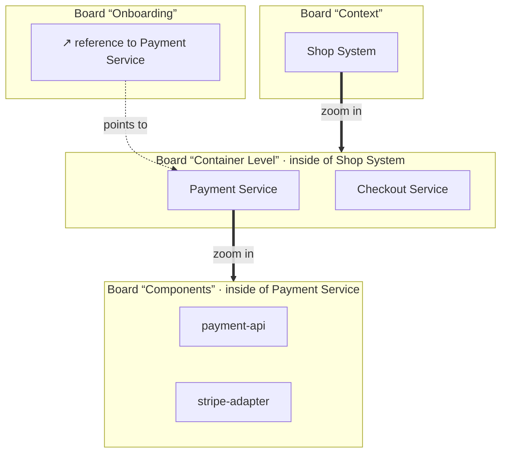

---
tags:
  - concept
aliases:
  - Home
  - Reference
  - References
  - Inner Board
  - Deleting
  - Stub
  - Implied Relation
---
# Board Graph

Abyme does not have one board but a board graph: boards, elements with a home, references on other boards, inner boards, and relations across board boundaries.

- **Every element has exactly one home:** a board or a frame.
- **On other boards it appears as a reference**, like a shortcut in a file system. A reference shows the element and leads to it, but is not an element of its own.
- **Every element can have an inner board**, its inside. Zooming in opens it. This is how C4 levels come about: you zoom in instead of copying something.

How the canvas shows one board of this graph at a time is described in [[Canvas#Projecting a Board]].

## Relations Across Boards

> [!question] Proposal

- **Both ends are on the board**, as an element or as a reference: then there is a normal arrow.
- **One end is not on the board:** then the canvas shows a **stub**, a short arrow on the element labeled with the target and its board, such as “uses → Stripe (board “External”)”. A click jumps to the target. If you want, you place a reference there, and the stub becomes a normal arrow.
- **Many stubs** are grouped per target board, such as “3 relations to “External””.
- **Implied relations:** If a component on the inner board of “Payment Service” uses the “Checkout Service”, the parent board derives an arrow from “Payment Service” to “Checkout Service”. Structurizr does the same and calls it [implied relationships](https://docs.structurizr.com/dsl/implied-relationships). Derived arrows are not stored and look different from real ones.

## Zooming In

> [!question] Proposal

1. From a certain zoom level on, an element shows a preview of its inner board.
2. Zooming further, the camera moves into the element, and the canvas fades over to the inner board.
3. A breadcrumb bar leads back up.

This gives the picture within the picture without all boards having to lie on one surface.

## Deleting

Removing something from the board means deleting it. There is no hiding. What gets deleted is always what you click:

- **A reference:** Only the reference disappears; the element stays.
- **An element:** It disappears everywhere. Beforehand, the system warns where there are still references or relations. Through `apply`, the warning is a rejection that names each element still relating to it, with the relation's kind; a request that first deletes those relations, or their sources, then deletes the element.
- **A representation in a synced zone:** This becomes a [[Change Requests|change request]] to the external resource.

> [!todo] Open
> - Stubs: group them from how many on, and how?
> - Implied relations: always show them, or only on request?
> - Does zooming far out lead back to the parent board?
