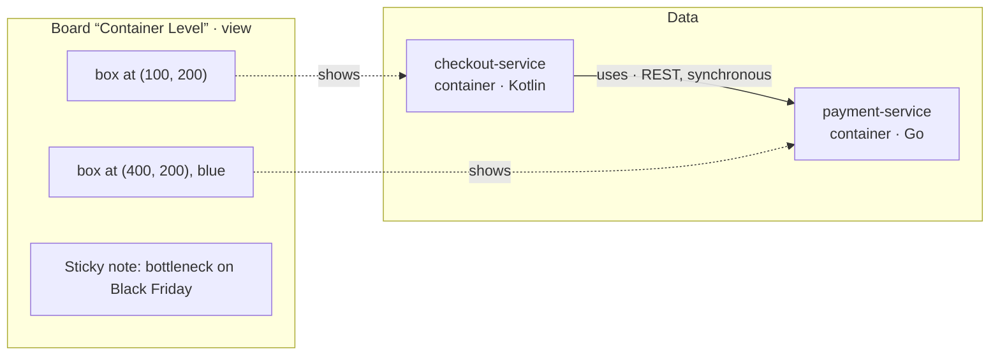

---
tags:
  - concept
aliases:
  - Element
  - Representation
  - Representations
  - Anchor
  - Native Element
  - View and Data
---
# Elements

## View and Data

Boards are the view and the working medium for people. The data behind them are elements with a stable identity and typed [[Relations]] between them. The position on the board belongs to the view, not to the element.



An element in the data looks roughly like this:

```
Element payment-service
  type:        container
  name:        Payment Service
  technology:  Go
  description: Handles payments through Stripe
```

The sticky note is an element too. It has an identity but exists only on this board.

What the separation gives you:

- **Renaming** is a single change, and every view is current.
- **Queries** such as “Who uses the Payment Service?” work across all boards.
- **Dependencies** attach to elements, not to drawings (see [[Checks]]).

## Native or Representation

| Kind | Description | Examples |
|---|---|---|
| **Native element** | exists only on the board | idea, target draft, sticky note, question, ADR |
| **Representation** | stands for something outside and has an **anchor** to that external resource | crate, file, document, image, DB table, ticket |

So one question matters for every element: **Does it stand for something outside?** [[Reconciliation]] and the chain of dependencies depend on the answer.

## Anchors

An anchor is a URI that connects a representation with what it stands for. Usually it points to a file or a folder in the repo, for example `file://crates/payment-service/` or `file://docs/api.md`. For sources outside the repo, a [[Extensions#Fetchers|fetcher]] will later define the scheme, such as `jira://PROJ-123`.

[[Boards and Zones|Zones]] can have anchors too. A Current frame on `file://crates/` then also notices newly added crates. How anchors make changes stand out is described in [[Reconciliation#Detecting Changes]].

## From Draft to Representation

A native element can become a representation when the idea becomes reality. After implementation, the target element “Notification Service” becomes a representation of `crates/notification`. See [[Current and Target]].
