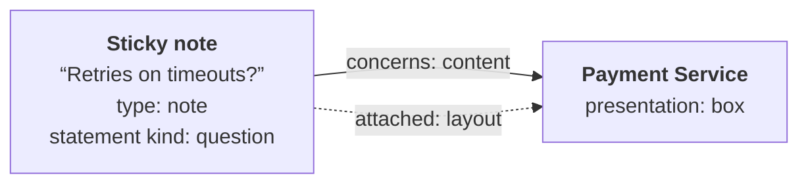

---
tags:
  - concept
aliases:
  - Sticky Note
  - Sticky Notes
  - Post-it
  - Attach
---
# Presentation

How something is presented is part of the board's content. Whoever creates an element, person or AI, also sets its presentation. The presentation belongs to the placement: the same element can appear as a box at home and as a card in a reference.

> [!question] Proposal
> The list is a first draft.

| Presentation | Used for |
|---|---|
| box | things in diagrams, e.g. a container |
| card | element with a title and a short text |
| note | sticky note like a Post-it |
| document | preview of a document |
| image | image or screenshot |
| chart | data series, e.g. benchmark results across several releases |
| table | tabular data |

Relations appear as arrows. Type packs define default presentations per type, e.g. boxes in a particular color for C4 containers (see [[Extensions#Type Packs]]). Exports show the presentation as faithfully as they can. If an export does not know a presentation, it shows a box with the summary.

## Sticky Notes

A sticky note is a native element of the type `note`, by which the canvas and the AI recognize it, so it looks the same on every board. The canvas shows its whole text in one fixed color.

**Attaching:** Dragging a note onto a box attaches it there, and so does creating it on a box. Two things happen:

- **Content:** The note gets the [[Relations|relation]] “concerns” to the box. It holds on every board, and the AI sees it.
- **Layout:** The placement remembers the box and the position relative to it. Moving the box moves the note along, but only on this board.

Dragging the note away again ends the attachment. The relation stays until you delete it, and deleting it ends the attachment too, on every board.

- **Allowed in every mode:** You should be able to comment on an approved target picture or a mirrored crate overview without changing it. Notes do not change the content of a zone, and reconciliation leaves them alone (see [[Boards and Zones#Modes]]).
- **The AI** creates and attaches notes the same way, for example a question on a box it does not understand: `attach_note` hangs a note on an element that is no note, where the note lies, and `detach_note` ends it (see [[Data Model#Operations]]). It attaches a note that a person pinned only once the person has agreed. A note with “@ai” becomes a task for it, see [[Ideas#Visual Collaboration with the AI]].
- **How to create notes in the canvas** is described in [[Canvas#Editing]], how they are stored in [[Storage in Git#Board File]].

> [!todo] Open
> - Do attached notes also appear where the box lies only as a reference?
> - Which colors belong to which statement kind?
> - How much Markdown can a note hold?
