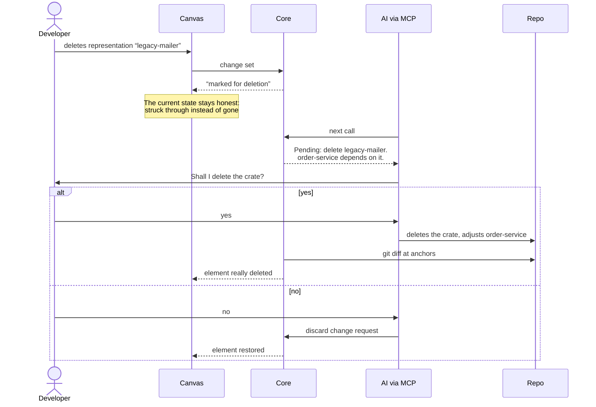

---
tags:
  - reconciliation
aliases:
  - Change Request
  - marked for deletion
---
# Change Requests

A change request arises when someone changes something in a synced zone that has to be implemented in the code. The flow by example: a crate is deleted on the board.

1. The element does not disappear right away but is shown as **“marked for deletion”**, for example struck through. The current state stays honest, because the crate still exists in the code.
2. On the next call, the MCP server tells the AI: “Pending: delete legacy-mailer. order-service depends on it.” The AI asks.
3. If the answer is yes, the AI changes the code. Reconciliation notices it, and the element is really deleted. If it is no, the element is restored.

Change requests are carried out by the AI. Later, a [[Extensions#Fetchers|fetcher]] can also carry them out directly, for example change a ticket status through an API.

> [!todo] Open
> - How are “marked for deletion” and other pending changes shown?
> - In which format are change requests stored?
