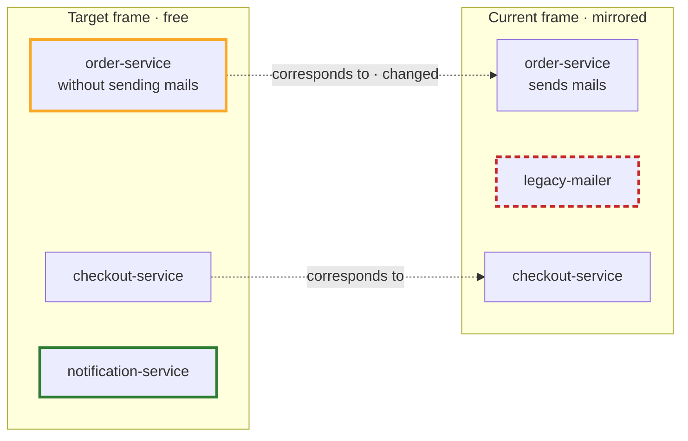

---
tags:
  - reconciliation
aliases:
  - Current
  - Target
  - Correspondence Link
  - Diff
---
# Current and Target

Current and Target lie as frames on **one** board. There is no need to look at several boards side by side.

- **Current frame:** in mode mirrored or synced, contains representations.
- **Target frame:** in mode free, contains native elements. It is created with “derive target from current”. Each copy gets a **correspondence link** to its current partner. After that, you change the target as you like.

In the example, the notification-service is new (green) and the order-service changed (yellow). The legacy-mailer goes away (red, dashed).

## Diff

The diff is computed continuously from the correspondence links:

| Situation | Meaning |
|---|---|
| target element without a current partner | new, still to be implemented |
| current element whose target partner was deleted | goes away |
| partners differ | changed |
| current element that appeared only after deriving | not yet considered in the target |

## Progress

Progress comes on its own. When the code changes, the current state follows, and the diff shrinks. Nobody has to tick anything off. When the diff is empty, the target is reached.

A target element can bring its **expected destination**, for example “becomes `crates/notification`”. Then the system detects the new current partner automatically. Otherwise the AI suggests the mapping.

## Plans

The way from current to target, that is the plan, does not have to live in Abyme. What matters is that current and target can be discussed well. If a decision is important, you can link it as an ADR element. Marking intermediate steps in the target is an [[Ideas|idea]].

> [!todo] Open
> - Is the target frame dissolved when the diff is empty, or does it stay as documentation?
> - How is the diff shown: as markers, as an overlay, or as a separate view?
