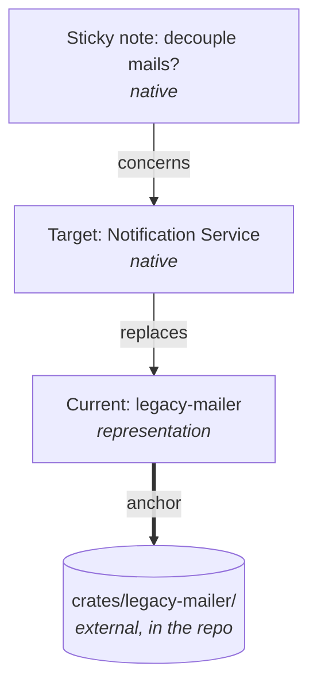

---
tags:
  - reconciliation
aliases:
  - Relation Chain
  - Detecting Changes
  - Direction of Changes
  - Base Snapshot
---
# Reconciliation

What the boards say should match reality. Where it does not, the system knows and reports it.

## The Relation Chain

Native elements and representations are connected through typed [[Relations]]. Changes travel along this chain in both directions.

- **From outside in:** The crate is deleted in the code. The representation disappears from the current state. The target element “replaces legacy-mailer” is thereby fulfilled, and the sticky note gets a review flag.
- **From inside out:** Someone deletes the representation in a synced zone. This becomes a [[Change Requests|change request]] to the code.

## Detecting Changes

Changes in the repo are detected without source-specific code, through anchors and Git. Only the interpretation needs the AI.

**Anchors** connect a representation with what it stands for (see [[Elements#Anchors]]):

| Anchor | points to | Element |
|---|---|---|
| `file://crates/payment-service/` | a folder | container “Payment Service” |
| `file://docs/api.md` | a file | document “API description” |
| `file://migrations/` | a folder | datastore “Orders DB” |
| `file://crates/` | a folder, as the anchor of a zone | Current frame “Crates” |

**Steps:**

1. Every representation carries a [[Checks#Verification Stamp|verification stamp]], such as “verified against commit 3f2a9c1”.
2. `git diff --name-status 3f2a9c1` lists the files that have changed since. `git status` adds new files that Git does not know yet.
3. Abyme matches the paths against the anchors. If a changed file lies under an anchor, the element gets a review flag. Through the relation chain, dependent elements are flagged too.
4. The AI rereads the affected places, updates the element, and sets a new verification stamp.

**Example:** Someone changes `crates/payment-service/src/refund.rs`. The file lies under the anchor `file://crates/payment-service/`, so “Payment Service” is flagged.

**Anchors of a zone** show what is missing or gone:

- New files under `crates/` that no anchor covers produce a hint: “new crate, not on the board”.
- If the path of an anchor no longer exists, the representation is orphaned. In a mirrored zone it disappears; otherwise it gets a review flag.
- Git detects renames. The anchor follows along.

**Limits:**

- Folder anchors are coarse, because every change in the folder flags the element. File anchors are finer, for example only on `Cargo.toml` and `src/lib.rs`. Anchors on functions or lines would break with every refactoring. Another way is described in [[#Finer Review Flags]].
- If the commit of the verification stamp is missing, for example after a rebase, the element is checked again from scratch.
- Git does not see changes outside the repo. For those there will later be [[Extensions#Fetchers|fetchers]].

**Parsers** are optional. Some things can be read exactly without the AI, such as crates and their dependencies from `Cargo.toml` (see [[Extensions#Parsers]]).

### Finer Review Flags

> [!question] Proposal

With the [[Extensions#Code Parser|code parser]], Abyme maps every changed place from `git diff` to a definition, such as a function or a type. The review flag then says what changed, and it gets a priority as in [[Checks]]:

| Change | Priority | Example |
|---|---|---|
| signature of a public definition, new or removed definition | task | `pub fn refund(order: OrderId)` gets a parameter `reason` |
| only the body of a function, or internals | hint | a bug in `refund()` is fixed |

- **Folder anchors get quieter.** Not every change in the folder is a task.
- **The AI has to read less.** Instead of “something changed in `crates/payment-service/`”, the flag says “signature of `refund()` changed”.
- **Limit:** A change in a body can also invalidate a statement on the board, for example when refunds suddenly run synchronously. That is why it produces a hint and not nothing.
- **Public** means something different in each language, such as `pub` in Rust or `export` in TypeScript. Where Abyme cannot tell, every signature counts.

## Direction of Changes

In synced zones, the system has to tell which side changed. The **base snapshot** comes from the Git history: the state of the board and the anchor files at the commit of the last check. This works like Git does when merging:

| Board differs from base snapshot | Source differs from base snapshot | Meaning | Reaction |
|---|---|---|---|
| yes | no | the person's intent | [[Change Requests\|change request]] to the source |
| no | yes | reality has changed | update the board |
| yes | yes | conflict | ask |

In mirrored zones, only the second row exists: reality leads, and the board follows.

## Triggers

- **On every MCP call** that concerns a zone with representations
- **After an implementation by the AI.** It knows what it changed.
- **Through a Git hook or file watcher**, for changes made by people
- **Periodically**, later, for sources without push, such as external APIs

Next: [[Checks]] · [[Change Requests]] · [[Current and Target]]
