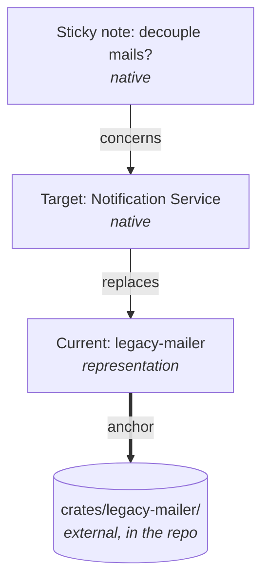

---
tags:
  - reconciliation
aliases:
  - Relation Chain
  - Detecting Changes
  - Direction of Changes
  - Base Snapshot
---
# Reconciliation

What the boards say should match reality. Where it does not, the system knows and reports it.

## The Relation Chain

Native elements and representations are connected through typed [[Relations]]. Changes travel along this chain in both directions.

- **From outside in:** The crate is deleted in the code. The representation disappears from the current state. The target element “replaces legacy-mailer” is thereby fulfilled, and the sticky note gets a review flag.
- **From inside out:** Someone deletes the representation in a synced zone. This becomes a [[Change Requests|change request]] to the code.

## Detecting Changes

Changes in the repo are detected without source-specific code, through anchors and Git. Only the interpretation needs the AI.

**Anchors** connect a representation with what it stands for (see [[Elements#Anchors]]):

| Anchor | points to | Element |
|---|---|---|
| `crates/payment-service` | a folder | container “Payment Service” |
| `docs/api.md` | a file | document “API description” |
| `migrations` | a folder | datastore “Orders DB” |
| `crates` | a folder, as the anchor of a zone | Current frame “Crates” |

**Steps:**

1. Every representation carries a [[Checks#Verification Stamp|verification stamp]], such as “verified against commit 3f2a9c1…”.
2. Git lists the files that have changed since: those whose committed or staged state differs from the stamp's commit, those changed in the working tree, and new files Git does not track and does not ignore. A renamed file counts as removed at its old path and added at its new one.
3. Abyme matches these paths against the anchors, byte for byte. If one lies under an anchor, the element gets a review flag, a task. So does an element with an anchor but no stamp, an element whose stamp names a commit the repository does not know or that is no ancestor of HEAD and that the stamp's recorded content does not vouch for (see [[#After a Rewrite]]), and an element whose anchor matches no file Git tracks or lists as untracked. An element whose relation points to an element with an anchor is flagged too when what that anchor stands for may have changed since its own stamp, because files under it changed since then or, for a target in a [[#Nested Repositories|nested repository]], that repository's commit changed, one hop and by the relation's kind (see [[Relations]]).
4. The AI rereads the affected places, updates the element, and calls `verify`, which stamps it with the commit HEAD names in the repository the anchor lies in and records the Git object each path the stamp vouches for held in that commit: the element's own anchor and the path that stands for each relation target that passes something on. `verify` refuses while files under the anchor are not committed, so the stamp names a commit that holds what was checked.

**Example:** Someone changes `crates/payment-service/src/refund.rs`. The file lies under the anchor `crates/payment-service`, so “Payment Service” is flagged.

**Anchors of a zone** show what is missing or gone:

- New files under `crates/` that no anchor covers produce a hint: “new crate, not on the board”.
- If the path of an anchor no longer exists, the representation is orphaned. In a mirrored zone it disappears; otherwise it gets a review flag.
- A renamed file counts as removed and added, so the anchor of its old path is flagged, and once nothing is left there, as matching no file.

**Limits:**

- Folder anchors are coarse, because every change in the folder flags the element. File anchors are finer, for example only on `Cargo.toml` and `src/lib.rs`. Anchors on functions or lines would break with every refactoring. Another way is described in [[#Finer Review Flags]].
- If the commit of the verification stamp is missing or no ancestor of HEAD and the stamp recorded no content, nothing tells what changed since: the element is checked again from scratch.
- Git does not see changes outside the repo. For those there will later be [[Extensions#Fetchers|fetchers]].
- Abyme finds a nested repository only where the outer repository's Git shows it: as a submodule, as a clone it tracks, or as a clone it lists as untracked. A clone in an ignored folder is not read, and neither is a nested repository that fails the [[Hexagonal Architecture#Security Baseline|security checks]]; anchors inside them match no file.

**Parsers** are optional. Some things can be read exactly without the AI, such as crates and their dependencies from `Cargo.toml` (see [[Extensions#Parsers]]).

### After a Rewrite

A rebase, a squash merge, or a cherry-pick rewrites the commits a stamp names, so the stamp's commit is no longer an ancestor of HEAD although nothing under the anchors may have changed. Then Abyme judges the stamp by the content it recorded, compared with what each path holds in the commit HEAD names:

- **The own anchor** is unflagged while it holds the recorded object; files under it that the index or the working tree changed since HEAD are flagged as in step 3. If it holds another object, or the stamp holds no entry for it, the element is flagged as a stamp whose commit is unknown: without the files that changed, it is checked from scratch.
- **A relation target** passes its flag on when the path that stands for it holds another object, the index or the working tree changed it, or the stamp did not record it, for example because the target was anchored elsewhere after the stamp.
- **An element without an anchor** that vouches for no path stays unflagged.
- **A stamp without recorded content** is flagged as a stamp whose commit is unknown and passes nothing on.

While the stamp's commit is an ancestor of HEAD, the recorded content plays no part.

### Nested Repositories

Repositories nested in the project, such as submodules and clones, belong to it (see [[Storage in Git#Project]]) but have their own history. Abyme reads one when an anchor lies in it, also several levels deep:

- **Inside a nested repository**, an element is measured there: `verify` stamps it with that repository's HEAD, and Git lists the changed files in it. `verify` refuses an element whose anchor lies in a nested repository that Abyme cannot read.
- **An anchor that contains a nested repository** is measured in its own repository. That repository sees a submodule or a clone it tracks as one path, which changes with the commit checked out in it, and does not see an untracked clone at all: changes inside never flag the anchor. Whoever wants the inside covered anchors the nested repository itself.
- **Relations** are measured in the source's repository, so a target inside a submodule or a tracked clone counts as changed when that repository's commit changed. Nothing is passed on to a source from a target inside an untracked clone, or from a target outside the nested repository the source lies in.

### Finer Review Flags

> [!question] Proposal

With the [[Extensions#Code Parser|code parser]], Abyme maps every changed place from `git diff` to a definition, such as a function or a type. The review flag then says what changed, and it gets a priority as in [[Checks]]:

| Change | Priority | Example |
|---|---|---|
| signature of a public definition, new or removed definition | task | `pub fn refund(order: OrderId)` gets a parameter `reason` |
| only the body of a function, or internals | hint | a bug in `refund()` is fixed |

- **Folder anchors get quieter.** Not every change in the folder is a task.
- **The AI has to read less.** Instead of “something changed in `crates/payment-service/`”, the flag says “signature of `refund()` changed”.
- **Limit:** A change in a body can also invalidate a statement on the board, for example when refunds suddenly run synchronously. That is why it produces a hint and not nothing.
- **Public** means something different in each language, such as `pub` in Rust or `export` in TypeScript. Where Abyme cannot tell, every signature counts.

## Direction of Changes

In synced zones, the system has to tell which side changed. The **base snapshot** comes from the Git history: the state of the board and the anchor files at the commit of the last check. This works like Git does when merging:

| Board differs from base snapshot | Source differs from base snapshot | Meaning | Reaction |
|---|---|---|---|
| yes | no | the person's intent | [[Change Requests\|change request]] to the source |
| no | yes | reality has changed | update the board |
| yes | yes | conflict | ask |

In mirrored zones, only the second row exists: reality leads, and the board follows.

## Triggers

- **On every MCP call** that concerns a zone with representations
- **After an implementation by the AI.** It knows what it changed.
- **Through a Git hook or file watcher**, for changes made by people
- **Periodically**, later, for sources without push, such as external APIs

Next: [[Checks]] · [[Change Requests]] · [[Current and Target]]
