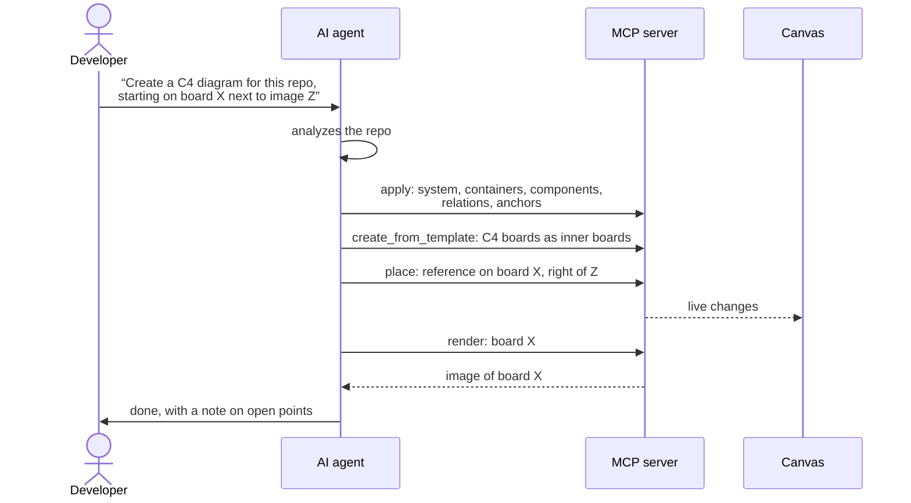

---
tags:
  - ai
  - example
---
# Example: C4 for a Repo

Request: “Create a C4 diagram for this repo, each level on its own board, with short descriptions, starting on board X next to image Z.”

1. The AI analyzes the repo. That is its own work, independent of Abyme.
2. **One** call creates the elements: system, containers, and components with descriptions, relations, and anchors. It is transactional.
3. **One** call creates the boards from the C4 template, as [[Board Graph|inner boards]] with auto-layout. The drill-down structure follows from the hierarchy.
4. **One** call places a reference to the context board on board X, “to the right of Z”.
5. The AI fetches an image of board X and checks the result (see [[Canvas#Visual Check]]).

That is about five calls instead of hundreds of single calls with self-computed coordinates. The tools are listed in [[MCP Server#Tools]].
