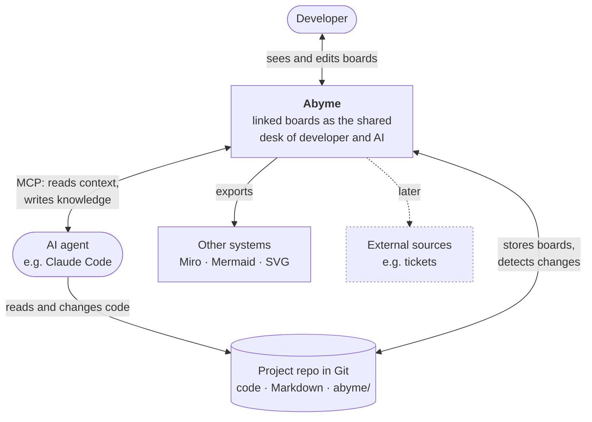
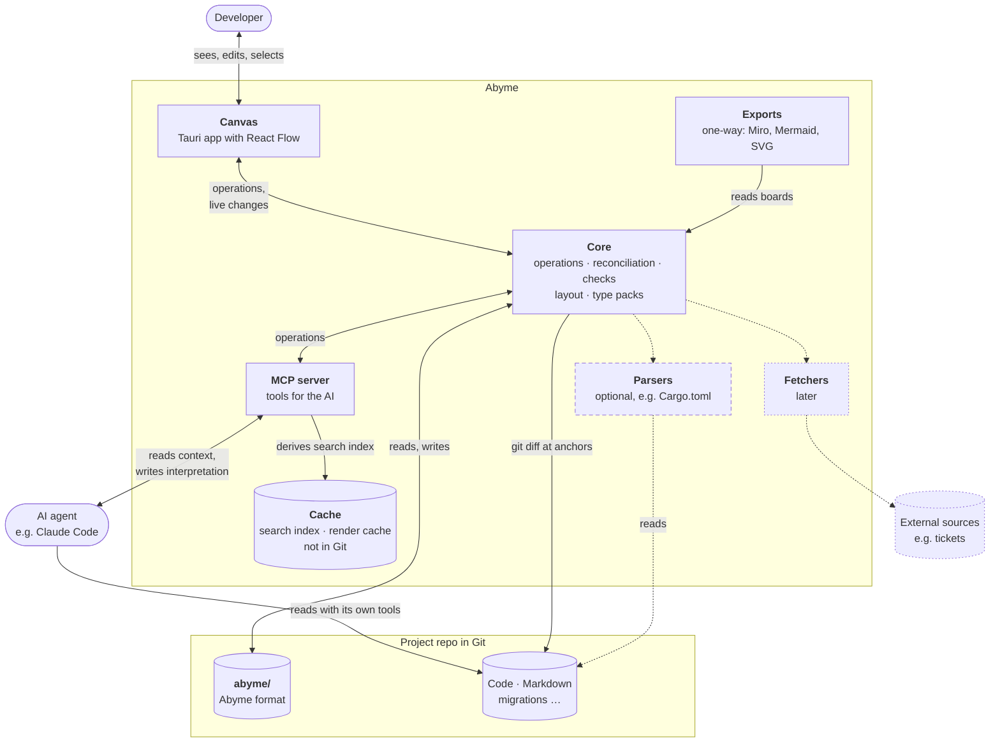

---
tags:
  - architecture
aliases:
  - Architecture
  - Overview
---
# Architecture Overview

Two levels, the way Abyme itself is meant to show C4 levels as inner boards: first Abyme in its surroundings, then zoomed into its building blocks. Dashed borders are proposals, dotted ones come later.

## Level 1 · Context

- The **developer** sees and edits the boards in the canvas.
- The **AI** reads Abyme through MCP as context and writes its interpretation of the repo back. It reads and changes the code with its own tools.
- Abyme **stores** the boards in the project repo and detects changes there.
- **Other systems** such as Miro get exports, in one direction only.
- **External sources** such as tickets come later.

## Level 2 · Building Blocks

| Building block | Job | More |
|---|---|---|
| Canvas | Tauri app in which the developer sees, edits, and selects boards | [[Canvas]] |
| Exports | output boards one-way to Miro, Mermaid, or SVG | [[Hourglass#Outputs]] |
| Core | operations on the format, reconciliation, checks, layout, type packs | [[Data Model]], [[Reconciliation]], [[Checks]], [[Placement and Layout]] |
| MCP server | tools for the AI | [[MCP Server]] |
| Parsers | read known formats without the AI, optional | [[Extensions#Parsers]] |
| Fetchers | connect external sources, later | [[Extensions#Fetchers]] |
| Cache | search index and render cache, not in Git | [[Search and Index]] |
| `abyme/` | the Abyme format in the project repo | [[Storage in Git]] |

**Hooks** for Git and Claude Code trigger reconciliation, see [[Project Knowledge and AI Memory]].

How content flows through Abyme is shown by the [[Hourglass]]. Who depends on whom, which crates exist, and how the parts work together at runtime is shown by the [[Hexagonal Architecture]].
