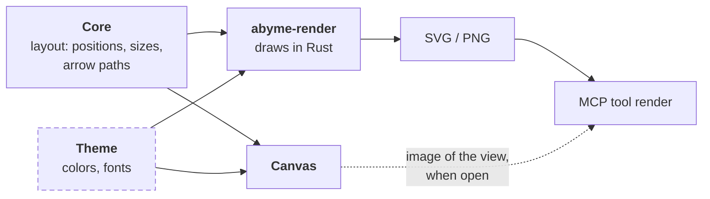

---
tags:
  - architecture
aliases:
  - abyme-canvas
  - React Flow
  - Tauri
  - Projection
  - Visual Check
  - Editing
---
# Canvas

The canvas is a Tauri app. Its UI is TypeScript with React and [React Flow](https://reactflow.dev/); everything else is Rust.

## Why Tauri and React Flow

1. **Ready-made mechanics:** React Flow brings camera, selection, dragging, connecting, resizing, and a minimap. That is the most laborious and least novel part of a canvas.
2. **One truth:** React Flow is controlled from outside. It keeps no persistent state of its own; the board graph stays in the core. Every change comes back as an object and can be translated into an operation in one place.
3. **Diagrams instead of sketches:** React Flow is made for nodes and edges, and that is exactly what Abyme boards are.
4. **License:** MIT, like Abyme itself.
5. **Presentations** such as documents, code, tables, and charts come ready-made from the React ecosystem.

Rejected:

- **tldraw**, because it needs a license key in production. That does not fit MIT.
- **Excalidraw**, because it has no custom element types.
- **Svelte Flow**, which is functionally equal, because of the smaller ecosystem and the two-way binding of state.
- **Dioxus** and other pure-Rust routes, because Rust has no comparably mature library and the canvas would become a custom build.

## Structure

- `crates/abyme-canvas` is the Tauri app. Its Rust side uses `abyme-core` directly, through the [[Hexagonal Architecture#Core API|core API]].
  - `src/app.rs` holds the IPC commands, the event, and the window; `src/boards.rs` and `src/projection.rs` the data the UI receives; `src/admission.rs` the writes the canvas may send; `src/watcher.rs` the file watcher; and `src/pages.rs` the pages the window may show.
  - `tauri.conf.json` and `capabilities/default.json` decide what the webview may reach. `build.rs` lists the canvas's own commands, so that Tauri checks them against the capabilities as well.
- The web UI lies next to it, in `crates/abyme-canvas/ui/`: React, built and served by Vite and tested with Vitest. It talks to the Rust side only through an interface, `AbymeClient` (`ui/src/client.ts`), which runs over Tauri's IPC; tests give the UI a fake one.
- The TypeScript types are generated from the Rust types with ts-rs into `ui/src/bindings.ts`. That way the format is defined only once, in `abyme-model`. A Rust test compares the committed file with the Rust types and fails when it is stale. The few IPC commands are typed by hand in `AbymeClient`.
- Layout and box sizes stay in Rust. The AI places things without a canvas too, so layout must work without a screen.

## Commands

The webview reaches the Rust side through four IPC commands and the event `project-changed`:

| Command | Takes | Does |
|---|---|---|
| `list_boards` | nothing | returns the project's boards as `overview` lists them, depth first, each with its ID, title, and depth in the tree of inner boards |
| `open_board` | a board ID | returns the board's projection (see [[#Projecting a Board]]) |
| `apply` | operations in the format of [[Data Model#Operations]] | applies them to the project through the core, all or none |
| `review_flags` | nothing | returns each element with a [[Checks\|review flag]], with its level (see [[#Projecting a Board]]) |

`apply` is the only command that writes. It passes a request on only when every operation in it is admitted, and it checks that before it touches the project. Today it admits these kinds. `move_element` of an existing element on an existing board that says `pinned`: with `true`, what a person moves stays where they put it (see [[Placement and Layout#Rules]]); with `false`, it releases the pin. And `update_element` of an existing element with a `name`, not blank and without a line break, a `body` of characters a file holds, and no other field. `delete_element` of an existing element. `attach_note` of an existing note to an existing element on an existing board, with `"pinned": true`, and `detach_note` of an existing note there. And, as a whole request, the three operations that create a note: `create_element` of the type `note` with the statement kind `idea`, a name and body by the same rule, and no summary or anchor, then `place_element` and `move_element` with `"pinned": true` of that element on one existing board, and at most, as the last operation, `attach_note` of that new note with `"pinned": true` to an existing element on the same board. `apply` returns the IDs of the elements it created. Under the project's lock, on the reading of the files the write starts from, so that no writer that takes the lock can change them in between, it then refuses a request that changes, deletes, attaches, or detaches an element whose file does not say it is a note, that deletes a note something hangs on, or that releases a pin anywhere but at the position in the board file, on every board alike, [[Boards and Zones#Modes|mirrored]] or not, naming at most the operation's position and the board; any of these writes nothing. That check catches a release from a stale view, which would move the box back; it authorizes nothing. The canvas sends the operation whenever the user finishes moving boxes: releasing a drag of one box or of several, which go in one request, or pressing an arrow key; and when the user clicks the marker of a pinned box, in order with the moves. `Delete` and `Backspace` delete the selected sticky notes, in one request and with no question, and the note stays on the screen until the board's next view leaves it out; a box or an arrow cannot be deleted on the canvas, and a note another element relates to, or that owns a board, is refused with the core's message. Every other operation, and a request with more operations than the core takes, is refused with the operation's position and kind and nothing of its content. The set of admitted operations grows one reviewed change to `src/admission.rs` at a time. That module matches every kind of operation by name, so a new operation in the core does not build until the canvas admits or refuses it. The UI's `AbymeClient` types `apply` with the admitted operations only.

## Live Updates

The canvas keeps no copy of the project beyond the view it shows. Its commands `list_boards` and `open_board` read the project through the core on every call, in the project that the directory the canvas started in lies in.

The Rust side watches the project's files itself: `abyme/`, `abyme/elements/`, and `abyme/boards/`, each on its own and only while it is a real directory. When a burst of changes has been quiet for a moment, it emits the event `project-changed`, which carries nothing, and the UI asks again for the list, for the open board, and for the review flags. When the open board cannot be read again, for example because a merge broke a file, it stays as last loaded with the core's message above it, and a line says it may be out of date; a write then fails with the core's message. A board that never loaded shows the message alone. Reading a file raises no event, so the reads that answer an event cannot raise the next one. A write of the AI over MCP, of an editor, or of `git checkout` shows up the same way.

## Security

- **No raw HTML:** The canvas shows names, summaries, descriptions, notes, relation labels, and the titles of other boards as text and renders no raw HTML from them. ESLint rejects the ways to write HTML into the page.
- **Only Abyme's own commands:** The webview reaches the Rust side only through the commands in [[#Commands]] and listening to events, not through plugins for files or the shell. The capability grants exactly these; a page from another origin reaches none of them. What the webview can write is limited to the operations `apply` admits.
- **Only its own pages:** The window navigates only to the canvas's own origin, and to the dev server's while it is developed; it opens no other window.
- **Only its own scripts:** The page's content security policy, in `ui/index.html`, lets it run only its own scripts. During development, Vite's dev server also sends the policy as a header, so that it covers the scripts Vite puts into the page. Once the page's modules have loaded, it freezes `Object.prototype`.
- **Git while open:** The canvas starts Git as the core does, when it opens, when its window gets focus or turns visible, every 30 s while it is visible, and whenever the project's files change, so start it only where you would run `git status`: a repository unpacked from an archive brings a `.git` whose filters then run.
- **No widened watch:** The watcher follows no symbolic link and watches no directory recursively, so a link in a cloned repository does not make it walk other directories.

The core's part is in [[Hexagonal Architecture#Security Baseline]].

## Scope

> [!question] Proposal

What gets built is a diagram editor, not a whiteboard. On a whiteboard there are shapes and strokes that mean something only to people, and arrows may point into nothing. In a diagram editor, everything has a type and an identity, and arrows always connect two elements. The AI can only read and check what has a type and an identity.

So that it still feels fast, sketching creates elements right away:

- Sticky notes and free text are native elements, created quickly with a keyboard shortcut (see [[Presentation#Sticky Notes]]).
- An arrow that ends in empty space creates a new element there.
- Shapes without meaning, scribbles, and freehand do not exist for now.

This includes camera, selection, moving, resizing, snapping, editing text in place, frames, references, undo, and keyboard shortcuts; arrows, moving between boards with a breadcrumb, a zoom bar, and highlighting what a selection is connected to are built. Later additions: highlighting the AI's changes live, handing the selection to the AI (`get_selection`), and letting the AI point at elements (`focus`), see [[Ideas#Visual Collaboration with the AI]].

## Projecting a Board

React Flow knows only one surface, no [[Board Graph]]. That fits, because the graph lives in the core. The canvas always shows one board as a projection: the elements and references on it and the arrows between them. Edits go back to the core as operations, and the core sends the new projection.

The canvas computes a board's projection from the core's snapshot, with pure functions in `src/projection.rs`: the command `open_board` takes a board ID and returns one entry per placement, with its position on the board and its size, which for an [[Storage in Git#Board File|attached note]] the core computes from the box it hangs on, whether the file pins it, the element's type, name, and summary, for a [[Presentation#Sticky Notes|sticky note]] its name and body instead, the box it hangs on while that attachment holds, or a mark that the element's file is missing, and the boards the element owns; the relations the board shows, as `read_board` shows them; and the boards above it. Of the boards above and inside it names only the ID and the title. The projection names its fields one by one and carries no element's body but a note's. Each entry becomes a box of the one node type `element`, at its position and size, and every box whose element file exists can be dragged or moved with the arrow keys, on every board; a box whose element file is missing can be moved on no board. A note shows its whole text in one fixed color and no pin marker, and any `▸` button on its top edge; it grows on the screen with its text, while its rect in the board file stays, so a long note can lie over what is below it. A double-click on a note opens its text field, on every board; `Esc` or a click next to it ends the input, but switching to another window does not. The first line becomes the name and the rest the body. Unchanged text and blank text write nothing, and blank text brings the old text back; when a write fails, the field stays open with the text and the board shows why. A note deleted while its field is open, as by the AI, stays where it lay with its field and text, and can be neither selected, moved, nor deleted; since a new element may have its ID by then, nothing is written from it: changed text shows that the note was deleted and its text not written, and keeps the field, and unchanged or blank text lets the note go, or gives its place to the box the latest view shows under its ID, which stays hidden until then. A click on the way to another board waits for that write and goes only if it worked. After a failure, the clicks of the press that ended the input stay, its double click included, and any later press goes, by the mouse or the keyboard. A pinned box (see [[Placement and Layout#Rules]]) shows a marker `pinned` on its top edge: a button that releases the pin and leaves the box where it is, or plain text on a box whose element file is missing, since the core releases no such pin. A box shows one `▸` button per board its element owns, and the open board shows a breadcrumb of the boards above it, as `overview` places them; both open a board and write nothing. One press opens at most one board: the rest of a double click whose first click opened one lands on the new board and opens nothing there, and starts no note; `Enter` or a later click opens as usual. Where a merge or a hand edit broke the tree, the breadcrumb ends there and the board stays reachable through the list. The list beside the board shows the boards as the tree `overview` shows: each board below the board it lies inside, indented by its depth up to eight levels, and a board whose chain is broken at the top level. A board with boards below it has a toggle that opens and closes its branch. When the canvas starts, only the top-level boards show; opening a board, from the list, a `▸` button, or the breadcrumb, opens every branch on the way to it, also one the user closed. A branch the user opened or closed otherwise stays so until the canvas closes, also when the list loads again after the files change. The list lies in a sidebar whose width a drag of the handle on its edge, or the arrow keys on the handle, changes from 10 to 40 rem; a double-click on the handle sets 16 rem, and a button collapses the sidebar so the board takes the whole width, without losing which branches are open. Width and collapsed state stay in the webview's storage for the next start, outside the repository; a stored width that is not a number gives 16 rem. A title too long for the sidebar is cut with “…” and shows in full as its button's tooltip. Each relation becomes an arrow from the bottom of its source to the top of its target, with React Flow's built-in edges, so arrows are not routed around boxes. An arrow shows the relation's label, cut after 40 characters, and no other text, and a `see_also` is dashed. Arrows cannot be selected, deleted, or reconnected, and a relation to an element on another board has none.

**A selection shows what it is connected to.** With one or more boxes or notes selected, the arrows leaving them are drawn thicker in orange and those entering them thicker in green, an arrow between two selected boxes counting as leaving, and each box at the other end of such an arrow gets a border in that arrow's color, orange when it is at both kinds of ends. Every other arrow and box is dimmed, except the box a selected note hangs on, the notes hanging on a selected box, and a note whose text field is open. Highlighted arrows stay below the boxes, as all arrows do. A click on an empty spot ends the selection and the highlighting. Only arrows the board draws count, so a relation to an element on another board highlights nothing.

A box of an element with a [[Checks|review flag]] shows a mark on its top edge, `⚠ task` or `⚠ hint`: the flag's level and no reason, which the AI or `read_element` gives. The command `review_flags` computes the flags apart from `open_board`, since Git can be slow, so it holds up neither boxes nor arrows nor a drag. The canvas does not ask per board: it asks when it opens and whenever the watcher sees a change. Since the watcher sees neither commits nor changes under an anchor, which is what raises flags, it also asks when its window gets focus or turns visible, as on a switch of workspaces, and every 30 s while it is visible, and never starts a run beside one still going. So the marks are at most one interval behind while Git answers; while a run is still going, they stay as they are. While the first answer is pending, a line above the board says so. When Git cannot be asked, the line says flags are unavailable and why, and no box is marked. In these two states a box without a mark does not read as clean.

| Abyme | in React Flow |
|---|---|
| board | one flow instance with nodes and edges |
| frame, zone | parent node (`parentId`) |
| element in a [[Presentation\|presentation]] | its own node type per presentation; a sticky note is so far the node type `element` with its own look |
| reference | the same node type with a marker. It fetches name and content through the element ID, so a rename shows up everywhere at once |
| relation | edge, computed from the relations |
| relation to another board | later a stub as its own node on the element; today no arrow |
| zooming in | a `▸` button on the box, or, on a box that is not a sticky note, a double-click for its first inner board; the inner board then opens with a fitted view |
| preview of the inner board | image from `abyme-render` in the node |
| locked zone | `draggable`, `connectable`, and `deletable` per node |
| attached sticky note | child node of the element it hangs on |
| live change by the AI | new state, React Flow redraws |

## Editing

> [!question] Proposal

React Flow reports every change through `onNodesChange` or `onConnect`. The canvas translates it into an operation in the format of the core API and sends it to the core. If a zone is locked, the canvas discards the change before that. Undo means running the inverse operation. **UI state** such as camera, selection, and an ongoing drag lives only in the canvas.

| The user wants to | React Flow brings | We build |
|---|---|---|
| pan and zoom | mouse, trackpad, touch | a zoom bar with keys (see below) |
| select, including several | click, selection box; lasso as an example | – |
| move elements | dragging, grid, arrow keys | one operation on release |
| resize | `NodeResizer` | one operation |
| edit text | nothing | a text field in the node, built for sticky notes. The class `nodrag` keeps text selection from moving the node |
| create something | examples for a sidebar and a context menu | toolbar, keyboard shortcuts, double-click on empty space |
| connect | handles on the nodes, reconnecting edges | choosing the relation type; an arrow into empty space creates an element |
| delete | Delete and Backspace | for sticky notes only, with no question; a refusal about references and relations shows as text (see [[Board Graph#Deleting]]) |
| tools on the element | `NodeToolbar` above the selected node | color, switching the presentation, zooming in |
| undo, copy, helper lines | only as paid Pro examples | ourselves, through operations |

**Zooming works like this,** on every board: the wheel or the trackpad zooms at the mouse, and the zoom bar at the bottom right shows the zoom as a whole percentage between `−`, which zooms the view out, and `+`, which zooms the view in. A click on the percentage sets 100 %, and the button next to `+` fits the whole board into view. The keys `+`, `-`, and `0` do the same as `+`, `−`, and fitting, also with Shift where the keyboard needs it for `+`, but not while a text field has the focus or with Ctrl, Meta, or Alt held, which stay the webview's. The zoom reaches from 10 % to 200 %, and fitting keeps to that range. React Flow's attribution link sits at the bottom left.

**A sticky note is created like this,** on every board: the key `N` or a double-click on an empty spot centre it on the mouse, and the toolbar, or `N` while the mouse is elsewhere, on the middle of the view. Its text field is active right away. `Esc` or a click next to it ends the input and writes it where it appeared, pinned, once; when its centre lies on a box then, by the rule a dropped note follows, the same request hangs it on that box, and otherwise it stands free, also when the box it was created on went or moved while the text was typed; blank text writes nothing, and the note goes. It stays on the screen until the board's next view lists it, or until a view asked for after the write answered leaves it out, as when another writer deleted it first; then it goes without a message. A double-click on an empty spot does not zoom. The note grows with its text.

**A sticky note is attached like this,** on every board: dropped, by a drag or the arrow keys, with its centre inside a box that is no note and whose file exists, it hangs on that box, on the one drawn on top where boxes overlap; dropped with its centre inside neither such a box nor the box it hangs on, it comes off that box; and dropped inside another box, it moves there. The canvas sends the move and then `attach_note` or `detach_note` in one request, and a drop on the same box sends only the move. An attached note is a child node of its box, so it follows a drag of the box, which writes only the box's move, and the arrow `concerns` from the note to its box is not drawn; its other arrows are. On every board a person deletes only a note that no board names as the box something hangs on, since a deletion takes the note from every board and would change those lines (see [[Storage in Git#Board File]]).

## Visual Check

The AI should see what the person sees. But the MCP server's `render` tool must not depend on the canvas for that. So the rule is **same geometry** instead of same pixels:

- Positions, sizes, and arrow paths come from the core's layout, colors and fonts from a shared theme.
- `abyme-render` redraws boxes, titles, and arrows in Rust, rich content such as charts only as placeholders. For the visual check, what matters most is the geometry: overlaps, legibility, and arrows.
- If the canvas is open, it can also deliver an image of its own view. Then the AI sees exactly what the person is seeing right now.

**Box sizes:** Layout without a screen has to know how big a box with a given text becomes. So the core estimates it from the width of each character (see [[Placement and Layout#Rules]]), and the canvas takes the size over instead of measuring itself. The canvas shows the system font, which no measurement in Rust could match, so a box can cut off text the estimate did not expect. The styles of a box use the line height and the wrapping the estimate assumes.

## Platforms and Risks

- **Desktop first**, as a Tauri app with access to files and Git. In the browser there is no file system and no Git; there the canvas needs `abyme serve` from [[Hexagonal Architecture#Runtime|stage B]].
- **Linux:** The webview there is WebKitGTK. How well it renders many elements must be shown by a test.
- **Box sizes** from Rust and the text in the webview can differ. The estimate leaves some room per character, and a box hides what does not fit.

Sources: [React Flow](https://reactflow.dev/), [React Flow examples](https://reactflow.dev/examples), [tldraw license key](https://tldraw.dev/sdk-features/license-key)
