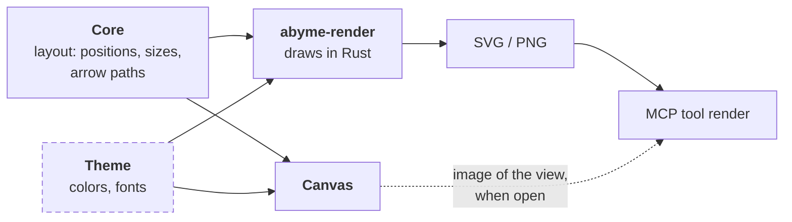

---
tags:
  - architecture
aliases:
  - abyme-canvas
  - React Flow
  - Tauri
  - Projection
  - Visual Check
  - Editing
---
# Canvas

The canvas is a Tauri app. Its UI is TypeScript with React and [React Flow](https://reactflow.dev/); everything else is Rust.

## Why Tauri and React Flow

1. **Ready-made mechanics:** React Flow brings camera, selection, dragging, connecting, resizing, and a minimap. That is the most laborious and least novel part of a canvas.
2. **One truth:** React Flow is controlled from outside. It keeps no persistent state of its own; the board graph stays in the core. Every change comes back as an object and can be translated into an operation in one place.
3. **Diagrams instead of sketches:** React Flow is made for nodes and edges, and that is exactly what Abyme boards are.
4. **License:** MIT, like Abyme itself.
5. **Presentations** such as documents, code, tables, and charts come ready-made from the React ecosystem.

Rejected:

- **tldraw**, because it needs a license key in production. That does not fit MIT.
- **Excalidraw**, because it has no custom element types.
- **Svelte Flow**, which is functionally equal, because of the smaller ecosystem and the two-way binding of state.
- **Dioxus** and other pure-Rust routes, because Rust has no comparably mature library and the canvas would become a custom build.

## Structure

- `crates/abyme-canvas` is the Tauri app. Its Rust side uses `abyme-core` directly, through the [[Hexagonal Architecture#Core API|core API]].
- The web UI lies next to it, in `crates/abyme-canvas/ui/`. It talks to the Rust side only through an interface, `AbymeClient`, which runs over Tauri's IPC.
- The TypeScript types are generated from the Rust types with ts-rs. That way the format is defined only once, in `abyme-model`. The few IPC commands are typed by hand in `AbymeClient`.
- Layout and text measurement stay in Rust. The AI places things without a canvas too, so layout must work without a screen.

## Security

- **No raw HTML:** The canvas shows names, summaries, descriptions, and notes as text and renders no raw HTML from them.
- **Only Abyme's own commands:** The webview reaches the Rust side only through Abyme's own IPC commands, not through plugins for files or the shell.

The core's part is in [[Hexagonal Architecture#Security Baseline]].

## Scope

> [!question] Proposal

What gets built is a diagram editor, not a whiteboard. On a whiteboard there are shapes and strokes that mean something only to people, and arrows may point into nothing. In a diagram editor, everything has a type and an identity, and arrows always connect two elements. The AI can only read and check what has a type and an identity.

So that it still feels fast, sketching creates elements right away:

- Sticky notes and free text are native elements, created quickly with a keyboard shortcut (see [[Presentation#Sticky Notes]]).
- An arrow that ends in empty space creates a new element there.
- Shapes without meaning, scribbles, and freehand do not exist for now.

This includes camera, selection, moving, resizing, snapping, editing text in place, arrows, frames, references, zooming in with a breadcrumb bar, undo, and keyboard shortcuts. Later additions: highlighting the AI's changes live, handing the selection to the AI (`get_selection`), and letting the AI point at elements (`focus`), see [[Ideas#Visual Collaboration with the AI]].

## Projecting a Board

React Flow knows only one surface, no [[Board Graph]]. That fits, because the graph lives in the core. The canvas always shows one board as a projection: the elements and references on it, the arrows between them, and stubs for relations to the outside. Edits go back to the core as operations, and the core sends the new projection.

| Abyme | in React Flow |
|---|---|
| board | one flow instance with nodes and edges |
| frame, zone | parent node (`parentId`) |
| element in a [[Presentation\|presentation]] | its own node type per presentation |
| reference | the same node type with a marker. It fetches name and content through the element ID, so a rename shows up everywhere at once |
| relation | edge, computed from the relations |
| relation to another board | stub as its own node on the element |
| zooming in | double-click, the camera moves into the element, then the inner board is loaded |
| preview of the inner board | image from `abyme-render` in the node |
| locked or mirrored zone | `draggable`, `connectable`, and `deletable` per node |
| attached sticky note | child node of the element it hangs on |
| live change by the AI | new state, React Flow redraws |

## Editing

> [!question] Proposal

React Flow reports every change through `onNodesChange` or `onConnect`. The canvas translates it into an operation in the format of the core API and sends it to the core. If a zone is locked, the canvas discards the change before that. Undo means running the inverse operation. **UI state** such as camera, selection, and an ongoing drag lives only in the canvas.

| The user wants to | React Flow brings | We build |
|---|---|---|
| pan and zoom | mouse, trackpad, touch | – |
| select, including several | click, selection box; lasso as an example | – |
| move elements | dragging, grid, arrow keys | one operation on release |
| resize | `NodeResizer` | one operation |
| edit text | nothing | a text field in the node. The class `nodrag` keeps text selection from moving the node |
| create something | examples for a sidebar and a context menu | toolbar, keyboard shortcuts, double-click on empty space |
| connect | handles on the nodes, reconnecting edges | choosing the relation type; an arrow into empty space creates an element |
| delete | Delete and Backspace | warning about references and relations (see [[Board Graph#Deleting]]) |
| tools on the element | `NodeToolbar` above the selected node | color, switching the presentation, zooming in |
| undo, copy, helper lines | only as paid Pro examples | ourselves, through operations |

**A sticky note is created like this:** key `N`, a double-click on an empty spot, or the toolbar. The note appears at the mouse, and its text field is active right away. `Esc` or a click next to it ends the input. The note grows with its text. Dragging it onto a box attaches it there.

## Visual Check

The AI should see what the person sees. But the MCP server's `render` tool must not depend on the canvas for that. So the rule is **same geometry** instead of same pixels:

- Positions, sizes, and arrow paths come from the core's layout, colors and fonts from a shared theme.
- `abyme-render` redraws boxes, titles, and arrows in Rust, rich content such as charts only as placeholders. For the visual check, what matters most is the geometry: overlaps, legibility, and arrows.
- If the canvas is open, it can also deliver an image of its own view. Then the AI sees exactly what the person is seeing right now.

**Text measurement:** Layout without a screen has to know how big a box with a given text becomes. So a Rust library for text layout computes the sizes, with bundled fonts, such as parley or cosmic-text. The canvas takes these sizes over instead of measuring itself. This comes with the MVP; the Working Skeleton uses fixed sizes. Fixed sizes for the MVP were rejected for exactly that reason.

## Platforms and Risks

- **Desktop first**, as a Tauri app with access to files and Git. In the browser there is no file system and no Git; there the canvas needs `abyme serve` from [[Hexagonal Architecture#Runtime|stage B]].
- **Linux:** The webview there is WebKitGTK. How well it renders many elements must be shown by a test.
- **Text sizes** from Rust and the rendering in the webview can differ slightly. Fixed fonts and some room around the text help.

> [!todo] Open
> - Which library for text layout?
> - Arrow routing: straight, orthogonal, or routed around obstacles?

Sources: [React Flow](https://reactflow.dev/), [React Flow examples](https://reactflow.dev/examples), [tldraw license key](https://tldraw.dev/sdk-features/license-key)
