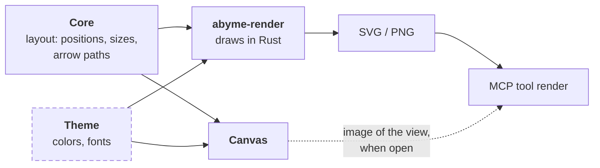

---
tags:
  - architecture
aliases:
  - abyme-canvas
  - React Flow
  - Tauri
  - Projection
  - Visual Check
  - Editing
---
# Canvas

The canvas is a Tauri app. Its UI is TypeScript with React and [React Flow](https://reactflow.dev/); everything else is Rust.

## Why Tauri and React Flow

1. **Ready-made mechanics:** React Flow brings camera, selection, dragging, connecting, resizing, and a minimap. That is the most laborious and least novel part of a canvas.
2. **One truth:** React Flow is controlled from outside. It keeps no persistent state of its own; the board graph stays in the core. Every change comes back as an object and can be translated into an operation in one place.
3. **Diagrams instead of sketches:** React Flow is made for nodes and edges, and that is exactly what Abyme boards are.
4. **License:** MIT, like Abyme itself.
5. **Presentations** such as documents, code, tables, and charts come ready-made from the React ecosystem.

Rejected:

- **tldraw**, because it needs a license key in production. That does not fit MIT.
- **Excalidraw**, because it has no custom element types.
- **Svelte Flow**, which is functionally equal, because of the smaller ecosystem and the two-way binding of state.
- **Dioxus** and other pure-Rust routes, because Rust has no comparably mature library and the canvas would become a custom build.

## Structure

- `crates/abyme-canvas` is the Tauri app. Its Rust side uses `abyme-core` directly, through the [[Hexagonal Architecture#Core API|core API]].
  - `src/app.rs` holds the IPC commands, the event, and the window; `src/boards.rs` and `src/projection.rs` the data the UI receives; `src/admission.rs` the writes the canvas may send; `src/watcher.rs` the file watcher; and `src/pages.rs` the pages the window may show.
  - `tauri.conf.json` and `capabilities/default.json` decide what the webview may reach. `build.rs` lists the canvas's own commands, so that Tauri checks them against the capabilities as well.
- The web UI lies next to it, in `crates/abyme-canvas/ui/`: React, built and served by Vite and tested with Vitest. It talks to the Rust side only through an interface, `AbymeClient` (`ui/src/client.ts`), which runs over Tauri's IPC; tests give the UI a fake one.
- The TypeScript types are generated from the Rust types with ts-rs into `ui/src/bindings.ts`. That way the format is defined only once, in `abyme-model`. A Rust test compares the committed file with the Rust types and fails when it is stale. The few IPC commands are typed by hand in `AbymeClient`.
- Layout and box sizes stay in Rust. The AI places things without a canvas too, so layout must work without a screen.

## Commands

The webview reaches the Rust side through three IPC commands and the event `project-changed`:

| Command | Takes | Does |
|---|---|---|
| `list_boards` | nothing | returns the project's boards, each with its ID and title |
| `open_board` | a board ID | returns the board's projection (see [[#Projecting a Board]]) |
| `apply` | operations in the format of [[Data Model#Operations]] | applies them to the project through the core, all or none |

`apply` is the only command that writes. It passes a request on only when every operation in it is admitted, and it checks that before it touches the project. Today it admits one kind: `move_element` of an existing element on an existing board with `"pinned": true`, so what a person moves stays where they put it (see [[Placement and Layout#Rules]]); the canvas does not release a pin. It then reads the project and refuses a request that moves an element on a [[Boards and Zones#Modes|mirrored]] board, which writes nothing. The canvas sends it whenever the user finishes moving boxes: releasing a drag of one box or of several, which go in one request, or pressing an arrow key. Boxes cannot be deleted on the canvas. Every other operation, and a request with more operations than the core takes, is refused with the operation's position and kind and nothing of its content. The set of admitted operations grows one reviewed change to `src/admission.rs` at a time. That module matches every kind of operation by name, so a new operation in the core does not build until the canvas admits or refuses it. The UI's `AbymeClient` types `apply` with the admitted operations only.

## Live Updates

The canvas keeps no copy of the project. Its commands `list_boards` and `open_board` read the project through the core on every call, in the project that the directory the canvas started in lies in.

The Rust side watches the project's files itself: `abyme/`, `abyme/elements/`, and `abyme/boards/`, each on its own and only while it is a real directory. When a burst of changes has been quiet for a moment, it emits the event `project-changed`, which carries nothing, and the UI asks again for the list and for the open board. Reading a file raises no event, so the reads that answer an event cannot raise the next one. A write of the AI over MCP, of an editor, or of `git checkout` shows up the same way.

## Security

- **No raw HTML:** The canvas shows names, summaries, descriptions, notes, relation labels, and the titles of other boards as text and renders no raw HTML from them. ESLint rejects the ways to write HTML into the page.
- **Only Abyme's own commands:** The webview reaches the Rust side only through the commands in [[#Commands]] and listening to events, not through plugins for files or the shell. The capability grants exactly these; a page from another origin reaches none of them. What the webview can write is limited to the operations `apply` admits.
- **Only its own pages:** The window navigates only to the canvas's own origin, and to the dev server's while it is developed; it opens no other window.
- **Only its own scripts:** The page's content security policy, in `ui/index.html`, lets it run only its own scripts. During development, Vite's dev server also sends the policy as a header, so that it covers the scripts Vite puts into the page. Once the page's modules have loaded, it freezes `Object.prototype`.
- **No widened watch:** The watcher follows no symbolic link and watches no directory recursively, so a link in a cloned repository does not make it walk other directories.

The core's part is in [[Hexagonal Architecture#Security Baseline]].

## Scope

> [!question] Proposal

What gets built is a diagram editor, not a whiteboard. On a whiteboard there are shapes and strokes that mean something only to people, and arrows may point into nothing. In a diagram editor, everything has a type and an identity, and arrows always connect two elements. The AI can only read and check what has a type and an identity.

So that it still feels fast, sketching creates elements right away:

- Sticky notes and free text are native elements, created quickly with a keyboard shortcut (see [[Presentation#Sticky Notes]]).
- An arrow that ends in empty space creates a new element there.
- Shapes without meaning, scribbles, and freehand do not exist for now.

This includes camera, selection, moving, resizing, snapping, editing text in place, frames, references, undo, and keyboard shortcuts; arrows and moving between boards with a breadcrumb are built. Later additions: highlighting the AI's changes live, handing the selection to the AI (`get_selection`), and letting the AI point at elements (`focus`), see [[Ideas#Visual Collaboration with the AI]].

## Projecting a Board

React Flow knows only one surface, no [[Board Graph]]. That fits, because the graph lives in the core. The canvas always shows one board as a projection: the elements and references on it and the arrows between them. Edits go back to the core as operations, and the core sends the new projection.

The canvas computes a board's projection from the core's snapshot, with pure functions in `src/projection.rs`: the command `open_board` takes a board ID and returns the board's mode; one entry per placement, with its rect from the board file, whether the file pins it, the element's type, name, and summary, or a mark that the element's file is missing, and the boards the element owns; the relations the board shows, as `read_board` shows them; and the boards above it. Of the boards above and inside it names only the ID and the title. The projection names its fields one by one and never carries an element's body. Each entry becomes a box of the one node type `element`, at its position and size, and a box on a mirrored board cannot be dragged or moved with the arrow keys. A pinned box (see [[Placement and Layout#Rules]]) shows a marker `pinned` on its top edge. A box shows one `▸` button per board its element owns, and the open board shows a breadcrumb of the boards above it, as `overview` places them; both open a board and write nothing. Where a merge or a hand edit broke the tree, the breadcrumb ends there and the board stays reachable through the list. Each relation becomes an arrow from the bottom of its source to the top of its target, with React Flow's built-in edges, so arrows are not routed around boxes. An arrow shows the relation's label, cut after 40 characters, and no other text, and a `see_also` is dashed. Arrows cannot be selected, deleted, or reconnected, and a relation to an element on another board has none.

| Abyme | in React Flow |
|---|---|
| board | one flow instance with nodes and edges |
| frame, zone | parent node (`parentId`) |
| element in a [[Presentation\|presentation]] | its own node type per presentation |
| reference | the same node type with a marker. It fetches name and content through the element ID, so a rename shows up everywhere at once |
| relation | edge, computed from the relations |
| relation to another board | later a stub as its own node on the element; today no arrow |
| zooming in | a `▸` button on the box, or a double-click for its first inner board; the inner board then opens with a fitted view |
| preview of the inner board | image from `abyme-render` in the node |
| locked or mirrored zone | `draggable`, `connectable`, and `deletable` per node |
| attached sticky note | child node of the element it hangs on |
| live change by the AI | new state, React Flow redraws |

## Editing

> [!question] Proposal

React Flow reports every change through `onNodesChange` or `onConnect`. The canvas translates it into an operation in the format of the core API and sends it to the core. If a zone is locked, the canvas discards the change before that. Undo means running the inverse operation. **UI state** such as camera, selection, and an ongoing drag lives only in the canvas.

| The user wants to | React Flow brings | We build |
|---|---|---|
| pan and zoom | mouse, trackpad, touch | – |
| select, including several | click, selection box; lasso as an example | – |
| move elements | dragging, grid, arrow keys | one operation on release |
| resize | `NodeResizer` | one operation |
| edit text | nothing | a text field in the node. The class `nodrag` keeps text selection from moving the node |
| create something | examples for a sidebar and a context menu | toolbar, keyboard shortcuts, double-click on empty space |
| connect | handles on the nodes, reconnecting edges | choosing the relation type; an arrow into empty space creates an element |
| delete | Delete and Backspace | warning about references and relations (see [[Board Graph#Deleting]]) |
| tools on the element | `NodeToolbar` above the selected node | color, switching the presentation, zooming in |
| undo, copy, helper lines | only as paid Pro examples | ourselves, through operations |

**A sticky note is created like this:** key `N`, a double-click on an empty spot, or the toolbar. The note appears at the mouse, and its text field is active right away. `Esc` or a click next to it ends the input. The note grows with its text. Dragging it onto a box attaches it there.

## Visual Check

The AI should see what the person sees. But the MCP server's `render` tool must not depend on the canvas for that. So the rule is **same geometry** instead of same pixels:

- Positions, sizes, and arrow paths come from the core's layout, colors and fonts from a shared theme.
- `abyme-render` redraws boxes, titles, and arrows in Rust, rich content such as charts only as placeholders. For the visual check, what matters most is the geometry: overlaps, legibility, and arrows.
- If the canvas is open, it can also deliver an image of its own view. Then the AI sees exactly what the person is seeing right now.

**Box sizes:** Layout without a screen has to know how big a box with a given text becomes. So the core estimates it from the width of each character (see [[Placement and Layout#Rules]]), and the canvas takes the size over instead of measuring itself. The canvas shows the system font, which no measurement in Rust could match, so a box can cut off text the estimate did not expect. The styles of a box use the line height and the wrapping the estimate assumes.

## Platforms and Risks

- **Desktop first**, as a Tauri app with access to files and Git. In the browser there is no file system and no Git; there the canvas needs `abyme serve` from [[Hexagonal Architecture#Runtime|stage B]].
- **Linux:** The webview there is WebKitGTK. How well it renders many elements must be shown by a test.
- **Box sizes** from Rust and the text in the webview can differ. The estimate leaves some room per character, and a box hides what does not fit.

Sources: [React Flow](https://reactflow.dev/), [React Flow examples](https://reactflow.dev/examples), [tldraw license key](https://tldraw.dev/sdk-features/license-key)
