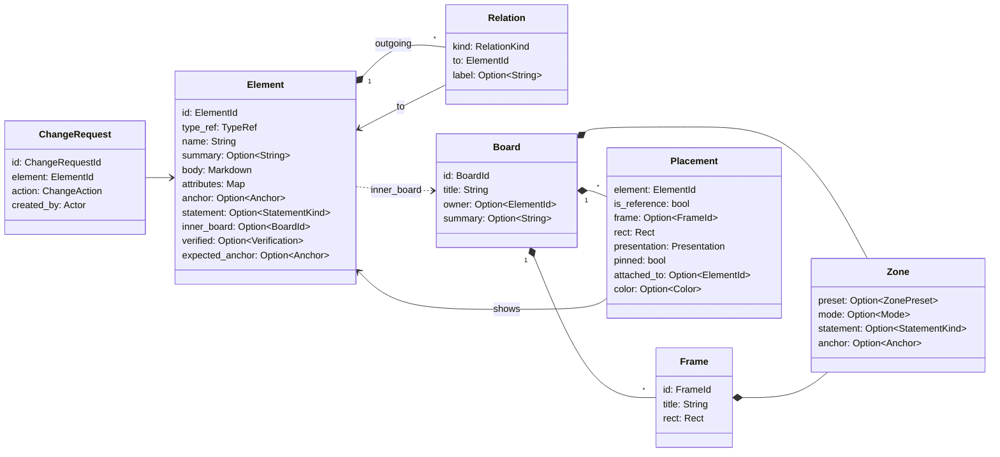

---
tags:
  - architecture
aliases:
  - Abyme Format
  - Waist
  - Format
  - Summary
  - Data Types
  - Types
---
# Data Model

The data model is the Abyme format, the waist of the [[Hourglass]]. Inputs and outputs use it together. It lives in the crate `abyme-model` and lies as files in Git (see [[Storage in Git]]). The type names are the ones the code will use, see [[Glossary]].

> [!question] Proposal
> The concepts behind it are decided. Names and fields of the types are a first draft.

## Overview



The most important separation: **Element** holds the content, **Board** and **Placement** hold the layout. Moving a box changes only the board (see [[Elements#View and Data]]).

## Types

```rust
/// Stable, readable ID, e.g. "payment-service".
/// Assigned on creation and never changes afterwards.
pub struct ElementId(String);
pub struct BoardId(String);
pub struct FrameId(String);

pub struct Element {
    pub id: ElementId,
    pub type_ref: TypeRef,                   // semantic type, e.g. "c4/container"
    pub name: String,
    pub summary: Option<String>,             // summary, for all outputs
    pub body: String,                        // description as Markdown
    pub attributes: BTreeMap<String, Value>, // type-specific, e.g. technology = "Go"
    pub anchor: Option<Anchor>,              // Some → representation, None → native
    pub statement: Option<StatementKind>,    // overrides the zone
    pub relations: Vec<Relation>,            // outgoing relations
    pub inner_board: Option<BoardId>,        // inner board, the inside of the element
    pub verified: Option<Verification>,      // verification stamp
    pub expected_anchor: Option<Anchor>,     // target elements only: expected destination
}

pub struct Relation {
    pub kind: RelationKind,                  // contains, depends_on, uses, corresponds_to, replaces, concerns, see_also
    pub to: ElementId,
    pub label: Option<String>,               // e.g. "REST, synchronous"
}

pub struct Anchor(Url);                      // file://crates/payment-service/, later jira://PROJ-123

pub struct Verification {
    pub commit: String,                      // commit of the last check
    pub by: Actor,                           // person or AI
}

pub struct Board {
    pub id: BoardId,
    pub title: String,
    pub owner: Option<ElementId>,            // whose inside this board is
    pub summary: Option<String>,
    pub zone: Zone,
    pub frames: Vec<Frame>,
    pub placements: Vec<Placement>,
}

pub struct Frame {
    pub id: FrameId,
    pub title: String,
    pub rect: Rect,
    pub zone: Zone,
}

pub struct Placement {
    pub element: ElementId,
    pub is_reference: bool,                  // false: home, true: reference
    pub frame: Option<FrameId>,
    pub rect: Rect,
    pub presentation: Presentation,
    pub pinned: bool,                        // placed by hand, auto-layout leaves it alone
    pub attached_to: Option<ElementId>,      // attached: rect is relative to this element
    pub color: Option<Color>,                // overrides the color from type and statement kind
}

pub struct Zone {
    pub preset: Option<ZonePreset>,          // Current, Target, Brainstorm, Archive
    pub mode: Option<Mode>,                  // overrides the preset
    pub statement: Option<StatementKind>,    // overrides the preset
    pub anchor: Option<Anchor>,              // e.g. a Current frame on crates/
}

pub enum Mode { Free, Synced, Mirrored, Locked }
pub enum StatementKind { Current, Target, Decision, Idea, Knowledge, Question, Historic }
pub enum Presentation { Box, Card, Note, Document, Image, Chart, Table }

pub struct ChangeRequest {
    pub id: ChangeRequestId,
    pub element: ElementId,
    pub action: ChangeAction,                // e.g. Delete
    pub created_by: Actor,
}

pub struct Rect { pub x: i32, pub y: i32, pub width: NonZeroU32, pub height: NonZeroU32 }
```

## Rules

- **IDs are readable slugs.** A valid ID consists of lowercase ASCII letters and digits joined by single hyphens, has at most 64 characters, and is none of the names Windows reserves for devices (`con`, `prn`, `aux`, `nul`, `com0`–`com9`, `lpt0`–`lpt9`). The core assigns IDs when it creates an element or board and never changes them. The same slugs appear in files, diffs, and the [[MCP Server#Detail Levels|board outline]]. Frame IDs are unique within their board.
- **How a name becomes a slug:** ASCII letters become lowercase, ASCII letters and digits stay, every other run of characters becomes one hyphen, and hyphens at the ends are dropped; so `Payment Service` becomes `payment-service`, and `Überweisung` becomes `berweisung`. A name without letters or digits becomes `element` or `board`. If the slug is taken, or is a reserved device name, it gets the suffix `-2`, `-3`, and so on; a slug longer than 64 characters is shortened so that it fits together with its suffix, and a hyphen left at the cut is dropped. An element ID that a board still places counts as taken even when its file is missing. A sticky note's slug will come from its first words, or be `note` if it has no text.
- **Representation or native:** An element is a representation if it has an `anchor` (see [[Elements]]).
- **Home:** Every element has exactly one `Placement` with `is_reference = false`. All others are references (see [[Board Graph]]). An element without a home, for example freshly created by the AI, is allowed and reported as a hint.
- **Arrows are not stored.** They follow from the relations. Deleting an arrow means deleting the relation.
- **The board decides what is shown and how.** The [[Presentation]] belongs to the placement; the default comes from the [[Extensions#Type Packs|type pack]].
- **Attaching is layout, “concerns” is content.** An attached sticky note has both: the relation in the element and `attached_to` in the placement (see [[Presentation#Sticky Notes]]).
- **Inheritance:** The effective mode and the effective statement kind come from the element, otherwise from the frame, otherwise from the board, otherwise from the type pack (see [[Boards and Zones#Inheritance]]).
- **Summaries are data:** short texts on elements and boards, written by the AI or supplied by a parser. The AI sees them in the [[MCP Server#Detail Levels|board outline]], the canvas for example as a tooltip.
- **Integer coordinates** keep the diffs calm.
- **Review flags are not part of the model.** They are computed from anchors, verification stamps, Git, and relations (see [[Checks]]).

## Operations

An operation is a delta held as data, such as creating, placing, moving, or pinning an element, or attaching a note. Applying operations is a pure function: it takes the current files and returns the file writes, and the core then carries them out (see [[Storage in Git#Writing]]). This makes it testable without a file system and lets operations travel between processes later.

A request is a list of operations, each a JSON object with the field `op`. The Working Skeleton has these:

```json
[
  {"op": "create_board", "key": "b", "title": "Container Level"},
  {"op": "create_element", "key": "pay", "type_ref": "c4/container", "name": "Payment Service",
   "summary": "Payment processing through Stripe", "body": "Handles payments."},
  {"op": "place_element", "element": {"new": "pay"}, "board": {"new": "b"}},
  {"op": "place_element", "element": {"existing": "orders-db"}, "board": {"new": "b"}},
  {"op": "move_element", "element": {"existing": "orders-db"}, "board": {"new": "b"}, "x": 400, "y": 200}
]
```

- **`create_element`** takes a key, `type_ref`, `name`, and optionally `summary` and `body`; **`create_board`** takes a key and `title`; **`place_element`** gives an element its home on a board; **`move_element`** sets the position of an element on a board where it lies, with `x` and `y` from -1,000,000 to 1,000,000, and keeps its size. Other fields are rejected.
- **References:** `{"new": "<key>"}` names what an earlier operation of the same request creates, `{"existing": "<id>"}` what already exists. A **local key** has 1 to 64 ASCII letters, digits, hyphens, and underscores, is valid only within its request, and elements and boards share one set of keys.
- **All or nothing:** Operations run in order. If one fails, for example because a key is unknown or an element already has a home, the request writes nothing, and the error names the operation's position. A request has at most 1000 operations.
- **The result** names the ID each key received; the canvas and the AI refer to the new elements and boards by these IDs from then on.
- **Placement:** The skeleton gives every placed element the size 180 × 90 and the first free cell of a grid near the board's origin, or a position below everything else. A placement never overlaps an element that an earlier operation of the same request moved.

The MCP server and the canvas use the same core functions:

- find the project a directory lies in, and read all of its elements and boards
- read and query, in [[MCP Server#Detail Levels|detail levels]]
- apply operations, transactionally
- place and auto-layout ([[Placement and Layout]])
- fetch and resolve checks and change requests

The core offers no subscription to changes. The canvas watches the project's files itself and reads them through the core again after a change (see [[Canvas#Live Updates]]).

> [!todo] Open
> **Provenance** (who created an element?) is not in yet, see [[Ideas]].
