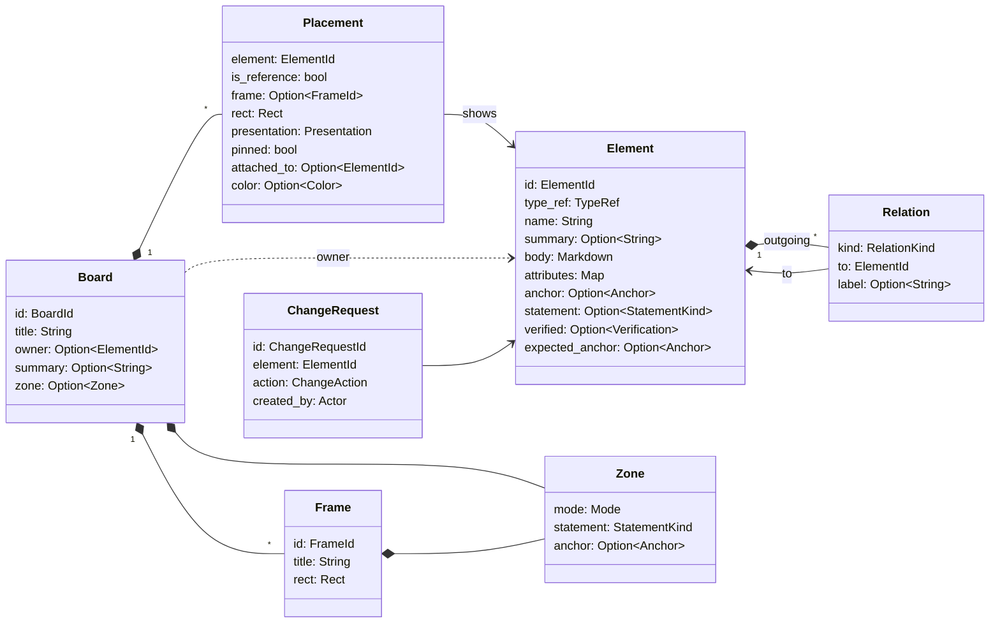

---
tags:
  - architecture
aliases:
  - Abyme Format
  - Waist
  - Format
  - Summary
  - Data Types
  - Types
---
# Data Model

The data model is the Abyme format, the waist of the [[Hourglass]]. Inputs and outputs use it together. It lives in the crate `abyme-model` and lies as files in Git (see [[Storage in Git]]). The type names are the ones the code will use, see [[Glossary]].

> [!question] Proposal
> The concepts behind it are decided. Names and fields of the types are a first draft.

## Overview



The most important separation: **Element** holds the content, **Board** and **Placement** hold the layout. Moving a box changes only the board (see [[Elements#View and Data]]).

## Types

```rust
/// Stable, readable ID, e.g. "payment-service".
/// Assigned on creation and never changes afterwards.
pub struct ElementId(String);
pub struct BoardId(String);
pub struct FrameId(String);

pub struct Element {
    pub id: ElementId,
    pub type_ref: TypeRef,                   // semantic type, e.g. "c4/container"
    pub name: String,
    pub summary: Option<String>,             // summary, for all outputs
    pub body: String,                        // description as Markdown
    pub attributes: BTreeMap<String, Value>, // type-specific, e.g. technology = "Go"
    pub anchor: Option<Anchor>,              // Some → representation, None → native
    pub statement: Option<StatementKind>,    // overrides the zone
    pub relations: Vec<Relation>,            // outgoing relations
    pub verified: Option<Verification>,      // verification stamp
    pub expected_anchor: Option<Anchor>,     // target elements only: expected destination
}

pub struct Relation {
    pub kind: RelationKind,                  // concerns, depends_on, describes, see_also, uses; later corresponds_to, replaces; contains is not stored and passes no review flags
    pub to: ElementId,
    pub label: Option<String>,               // e.g. "REST, synchronous"
}

pub struct Anchor(String);                   // path relative to the project root, e.g. crates/payment-service

pub struct Verification {
    pub commit: CommitId,                    // full commit ID of the last check, in the anchor's repository
    pub by: Verifier,                        // ai or person, a label, not a checked identity
}

pub struct Board {
    pub id: BoardId,
    pub title: String,
    pub owner: Option<ElementId>,            // whose inside this board is
    pub summary: Option<String>,
    pub zone: Option<Zone>,                  // a board without one is no zone
    pub frames: Vec<Frame>,
    pub placements: Vec<Placement>,
}

pub struct Frame {
    pub id: FrameId,
    pub title: String,
    pub rect: Rect,
    pub zone: Option<Zone>,
}

pub struct Placement {
    pub element: ElementId,
    pub is_reference: bool,                  // false: home, true: reference
    pub frame: Option<FrameId>,
    pub rect: Rect,
    pub presentation: Presentation,
    pub pinned: bool,                        // placed by hand, auto-layout leaves it alone
    pub attached_to: Option<ElementId>,      // attached: rect is relative to this element
    pub color: Option<Color>,                // overrides the color from type and statement kind
}

pub struct Zone {
    pub mode: Mode,
    pub statement: StatementKind,
    pub anchor: Option<Anchor>,              // e.g. a Current frame anchored on crates
}

pub enum Mode { Free, Mirrored }             // later Synced, Locked
pub enum StatementKind { Current, Decision, Idea, Knowledge, Question, Target }   // later Historic
pub enum Presentation { Box, Card, Note, Document, Image, Chart, Table }

pub struct ChangeRequest {
    pub id: ChangeRequestId,
    pub element: ElementId,
    pub action: ChangeAction,                // e.g. Delete
    pub created_by: Actor,
}

pub struct Rect { pub x: i32, pub y: i32, pub width: NonZeroU32, pub height: NonZeroU32 }
```

## Rules

- **IDs are readable slugs.** A valid ID consists of lowercase ASCII letters and digits joined by single hyphens, has at most 64 characters, and is none of the names Windows reserves for devices (`con`, `prn`, `aux`, `nul`, `com0`–`com9`, `lpt0`–`lpt9`). The core assigns IDs when it creates an element or board and never changes them. The same slugs appear in files, diffs, and the [[MCP Server#Detail Levels|board outline]]. Frame IDs are unique within their board.
- **How a name becomes a slug:** ASCII letters become lowercase, ASCII letters and digits stay, every other run of characters becomes one hyphen, and hyphens at the ends are dropped; so `Payment Service` becomes `payment-service`, and `Überweisung` becomes `berweisung`. A name without letters or digits becomes `element` or `board`. If the slug is taken, or is a reserved device name, it gets the suffix `-2`, `-3`, and so on; a slug longer than 64 characters is shortened so that it fits together with its suffix, and a hyphen left at the cut is dropped. An element ID that a board still places counts as taken even when its file is missing. A sticky note's slug will come from its first words, or be `note` if it has no text.
- **Representation or native:** An element is a representation if it has an `anchor` (see [[Elements]]).
- **Anchors are paths in the project,** relative to its root, covering the path and everything below it. An anchor is kept as written, never normalized, and rejected when it is empty, starts or ends with `/`, has an empty, `.`, or `..` segment, holds a backslash, a colon, or a character a reader cannot see, is longer than 4096 bytes or has a segment longer than 255 bytes, or lies in `abyme` or `.abyme` at the project root or in a `.git` folder (case does not count for these names).
- **A verification stamp** names a full commit ID (40 or 64 lowercase hex digits) of the repository the element's anchor lies in, a nested one or the project's, and who verified, `ai` or `person`. An element without an anchor can carry one too, a commit of the project's repository.
- **Inner boards:** A board's `owner` names the element whose inside it is. An element owns at most one board, and no board lies inside itself: the board above a board is the home board of its owner, and going up from a board never reaches it again. An owner needs no home; its board then has nothing above it. Merges and hand edits can still break these rules, so readers show such boards instead of failing.
- **Zones:** A board's zone names its mode and its statement kind, both required. The file stores these two, never a preset: a [[Boards and Zones#Zone Presets|zone preset]] is a named pair, such as Current for mirrored and current. Abyme knows the modes free and mirrored and the kinds current, decision, idea, knowledge, question, and target so far; any other value is rejected.
- **Home:** Every element has exactly one `Placement` with `is_reference = false`. All others are references (see [[Board Graph]]). An element without a home, for example freshly created by the AI, is allowed and reported as a hint.
- **Arrows are not stored.** They follow from the relations. Deleting an arrow means deleting the relation.
- **One relation per kind and target:** an element has at most one relation of a kind to a target, and none to itself. A relation to an element whose file is missing is read like any other (see [[Checks#Structural (Deterministic)|structural checks]]).
- **The board decides what is shown and how.** The [[Presentation]] belongs to the placement; the default comes from the [[Extensions#Type Packs|type pack]].
- **Attaching is layout, “concerns” is content.** An attached sticky note has both: the relation in the element and `attached_to` in the placement (see [[Presentation#Sticky Notes]]).
- **Inheritance:** An element's statement kind is that of its home board's zone. Without a home, or when its home is no zone, it has none: no other board that places it and no board above stands in (see [[Boards and Zones#Inheritance]]).
- **Summaries are data:** short texts on elements and boards, written by the AI or supplied by a parser. The AI sees them in the [[MCP Server#Detail Levels|board outline]], the canvas for example as a tooltip.
- **Integer coordinates** keep the diffs calm.
- **Review flags are not part of the model.** They are computed from anchors, verification stamps, Git, and relations (see [[Checks]]).

## Operations

An operation is a delta held as data, such as creating, placing, moving, or pinning an element, or attaching a note. Applying operations is a pure function: it takes the current files and returns the file writes, and the core then carries them out (see [[Storage in Git#Writing]]). This makes it testable without a file system and lets operations travel between processes later.

A request is a list of operations, each a JSON object with the field `op`:

```json
[
  {"op": "create_board", "key": "b", "title": "Container Level"},
  {"op": "create_element", "key": "pay", "type_ref": "c4/container", "name": "Payment Service",
   "summary": "Payment processing through Stripe", "body": "Handles payments.",
   "anchor": "crates/payment-service"},
  {"op": "place_element", "element": {"new": "pay"}, "board": {"new": "b"}},
  {"op": "place_element", "element": {"existing": "orders-db"}, "board": {"new": "b"}},
  {"op": "move_element", "element": {"existing": "orders-db"}, "board": {"new": "b"}, "x": 400, "y": 200},
  {"op": "update_element", "element": {"existing": "orders-db"}, "summary": null, "body": "Orders and payments.",
   "anchor": "migrations"},
  {"op": "delete_element", "element": {"existing": "legacy-mailer"}},
  {"op": "create_relation", "from": {"new": "pay"}, "kind": "uses", "to": {"existing": "orders-db"},
   "label": "SQL"},
  {"op": "delete_relation", "from": {"existing": "web-shop"}, "kind": "depends_on", "to": {"existing": "legacy-api"}}
]
```

- **`create_element`** takes a key, `type_ref`, `name`, and optionally `summary`, `body`, and `anchor`; **`create_board`** takes a key, `title`, and optionally `summary`, `owner`, the element whose inside the board is, and `zone`, such as `{"mode": "mirrored", "statement": "current"}`; **`place_element`** gives an element its home on a board; **`move_element`** sets the position of an element on a board where it lies, with `x` and `y` from -1,000,000 to 1,000,000, and keeps its size. Other fields are rejected.
- **`update_element`** changes only the fields it names among `name`, `type_ref`, `summary`, `body`, and `anchor`; `"summary": null` and `"anchor": null` remove them, and `null` is rejected for the others. The element keeps its ID and its relations, also when its name changes, and an update that names no field is rejected. Text is stored exactly as sent.
- **`update_board`** changes only the fields it names among `title`, `summary`, `owner`, and `zone`; `"summary": null`, `"owner": null`, and `"zone": null` remove them, and `null` is rejected for the title. The board keeps its ID and its placements, and an update that names no field is rejected.
- **Inner boards in a request:** `create_board`, `update_board`, and `place_element` are rejected when, as the request stands, they would make an element own a second board or a board lie inside itself, or name an owner that is no element. A breach that the files already hold rejects nothing else, so a request can repair it step by step.
- **`delete_element`** removes an element's file, its placement on every board, and its own relations. It is rejected while other elements still relate to it, or while a board names it as its owner, as the request stands at that operation; the error names each source and the relation's kind, or the board. It also takes an ID that a board places although its file is missing, and then removes only the placements. A deleted element cannot be named again in the same request, and its ID stays taken there.
- **A content change removes the verification stamp:** `update_element`, `create_relation`, and `delete_relation` remove the stamp of the element they change, also when an update leaves every value as it was. No operation sets a stamp: only the tool `verify` does, with the commit it reads itself (see [[Checks#Verification Stamp]]). An anchor passes the [[#Rules|rules]] above; whether its path exists is not checked.
- **`create_relation`** adds a relation from `from` to `to` of a `kind` (see [[Relations]]), with an optional `label`; it is rejected when the element has that relation already or would point to itself. **`delete_relation`** removes the relation with `from`, `kind`, and `to`; its `to` is only looked up among the relations of `from`, so a relation to an element whose file is gone can still be removed. Both rewrite only the element file of `from`.
- **References:** `{"new": "<key>"}` names what an earlier operation of the same request creates, `{"existing": "<id>"}` what already exists. A **local key** has 1 to 64 ASCII letters, digits, hyphens, and underscores, is valid only within its request, and elements and boards share one set of keys.
- **All or nothing:** Operations run in order. If one fails, for example because a key is unknown or an element already has a home, the request writes nothing, and the error names the operation's position. A request has at most 1000 operations.
- **The result** names the ID each key received; the canvas and the AI refer to the new elements and boards by these IDs from then on.
- **Placement:** The skeleton gives every placed element the size 180 × 90 and the first free cell of a grid near the board's origin, or a position below everything else. A placement never overlaps an element that an earlier operation of the same request moved.

The MCP server and the canvas use the same core functions:

- find the project a directory lies in, and read all of its elements and boards
- read and query, in [[MCP Server#Detail Levels|detail levels]]
- apply operations, transactionally
- place and auto-layout ([[Placement and Layout]])
- fetch and resolve checks and change requests

The core offers no subscription to changes. The canvas watches the project's files itself and reads them through the core again after a change (see [[Canvas#Live Updates]]).

> [!todo] Open
> **Provenance** (who created an element?) is not in yet, see [[Ideas]].
