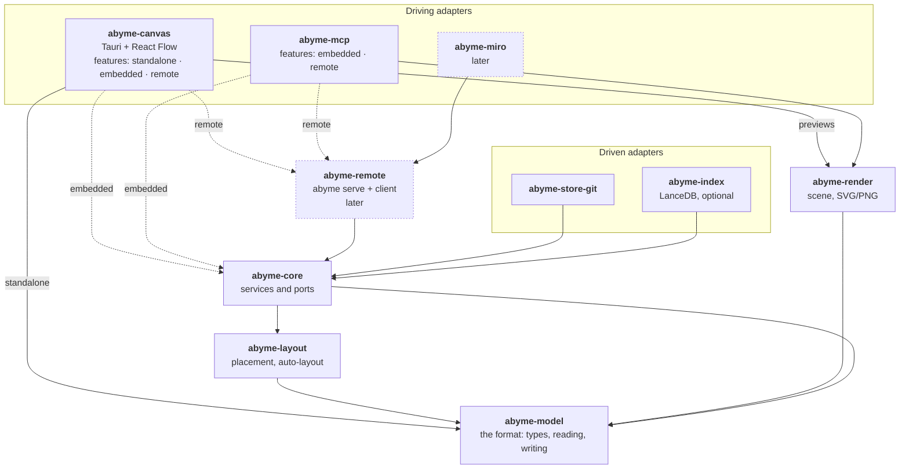

---
tags:
  - architecture
aliases:
  - Ports and Adapters
  - Hexagon
  - Crates
  - Core API
  - Runtime
---
# Hexagonal Architecture

## Principle

- **Canvas, core, and MCP server can be used and built independently of each other.**
- **The core is the backend.** The canvas uses it but can also be used alone, for example to create diagrams for yourself.
- **The core also works without the canvas**, with another visual medium such as Miro. The visual medium is a projection of the data from the core. How it prepares the data is its own business.
- **Dependencies point inward.** The core defines ports. **Driving adapters** call it through the input port, such as the canvas, the MCP server, and the Miro bridge. **Driven adapters** are called by the core through its output ports, such as storage, Git, and the search index.
- **Adapters attach as a Rust feature or as a separate package** that talks to the core through an API (Unix socket, network).

The [[Hourglass]] shows what flows, the hexagon who depends on whom. The MCP server is an input there and a driving adapter here.

> [!question] Proposal
> From here on, everything is a proposal, except the location of the crates under `crates/`.

## Core API

The core defines its input port as a trait (working name `AbymeApi`) and offers two implementations:

- **embedded:** The core runs in the same process and is included as a Cargo feature.
- **remote:** A client talks to a local core process (`abyme serve`) over a Unix socket or the network.

Canvas, MCP server, and Miro bridge program only against the trait. Whether the core runs in the same process or remotely is a question of the build and the configuration, not of the architecture.

- **Precondition:** Operations and events are expressed as data, that is serializable (see [[Data Model#Operations]]).
- **Bonus:** Through a language-neutral protocol, such as JSON-RPC as in LSP and MCP, adapters in other languages can attach too.

## Standalone Use

| Variant | Building blocks | For |
|---|---|---|
| canvas alone | canvas, format | diagrams for yourself |
| core with MCP | core, storage, MCP server | AI memory without a canvas |
| core with Miro | core, storage, Miro bridge, optionally MCP server | display in Miro, one-way only |
| everything | canvas, core, MCP server | the full shared desk |

The format is a crate of its own (`abyme-model`). The canvas alone is thereby a simple diagram editor that writes Abyme files. With the core, reconciliation, checks, and current/target come on top, on the same files. A diagram from the standalone canvas can thus be promoted later without conversion.

So that the MCP server does not depend on the canvas, **render** and **layout** are crates of their own. The `render` tool draws through `abyme-render` (see [[Canvas#Visual Check]]), and placement and auto-layout from `abyme-layout` are used by the MCP server and the canvas alike.

## Crates

```toml
# Cargo.toml in the project root
[workspace]
resolver = "3"
members = ["crates/*"]
```

Dotted is what comes later.



| Crate | Job |
|---|---|
| `abyme-model` | the format: types, reading, writing (see [[Data Model]]) |
| `abyme-core` | services such as reconciliation, checks, current/target, and search, plus the ports |
| `abyme-layout` | placement and auto-layout |
| `abyme-render` | scene from the format, as SVG/PNG for the visual check, previews, and export |
| `abyme-store-git` | storage adapter for `abyme/` and Git |
| `abyme-index` | search index with LanceDB, optional (see [[Search and Index]]) |
| `abyme-mcp` | MCP server |
| `abyme-canvas` | Tauri app with React Flow (see [[Canvas]]) |
| `abyme-remote` | `abyme serve` and the matching client, later |
| `abyme-miro` | Miro bridge, later |

## Runtime

- **Stage A, first:** Everything runs embedded. The files in `abyme/` are the shared state, and file watchers deliver the live updates, the way Obsidian deals with external editors. This is simple and fits Git. The risk is concurrent writing; atomic writes and small files help against it.
- **Stage B, later:** `abyme serve` runs as a local process, and all adapters are clients. This is more consistent and allows real subscriptions and adapters in other languages.

The MCP server is started by the client per AI session, so “embedded” is the simplest there. With the trait from [[#Core API]], the switch from A to B works without rebuilding the adapters.

> [!todo] Open
> - **Protocol** for stage B: JSON-RPC or something else?
> - **Concurrent editing** by a person and the AI in stage A: How are conflicts resolved?
