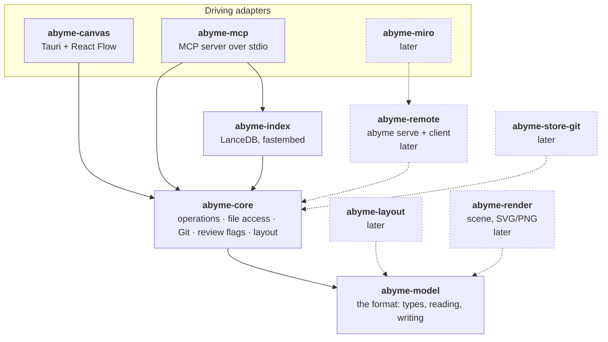

---
tags:
  - architecture
aliases:
  - Ports and Adapters
  - Hexagon
  - Crates
  - Core API
  - Runtime
  - Security Baseline
---
# Hexagonal Architecture

## Principle

- **Canvas, core, and MCP server can be used and built independently of each other.**
- **The core is the backend.** The canvas uses it but can also be used alone, for example to create diagrams for yourself.
- **The core also works without the canvas**, with another visual medium such as Miro. The visual medium is a projection of the data from the core. How it prepares the data is its own business.
- **Dependencies point inward.** The core defines ports. **Driving adapters** call it through the input port, such as the canvas, the MCP server, and the Miro bridge. **Driven adapters** are called by the core through its output ports, such as storage, Git, and the search index.
- **Adapters depend on the core crate** and run the core in their own process. From [[#Runtime|stage B]] on, they can also be separate clients of `abyme serve` (Unix socket, network).

The [[Hourglass]] shows what flows, the hexagon who depends on whom. The MCP server is an input there and a driving adapter here.

A port gets its own trait only once a second implementation needs it. Until then, the core holds the file access and the Git queries itself, and the MCP server uses the search index directly.

## Core API

For now, the core's input port is the public API of the crate `abyme-core`. Canvas and MCP server call it directly, each in its own process.

- **Operations and events are data**, that is serializable (see [[Data Model#Operations]]).
- **With stage B** (see [[#Runtime]]), the input port becomes a trait (working name `AbymeApi`) with two implementations: **embedded**, with the core in the same process, and **remote**, with a client that talks to `abyme serve` over a Unix socket or the network. Because operations are already data, the trait can be extracted then without changing what the adapters do.
- **Bonus:** Through a language-neutral protocol, such as JSON-RPC as in LSP and MCP, adapters in other languages can attach too.

## Standalone Use

| Variant | Building blocks | For |
|---|---|---|
| canvas alone | canvas, format | diagrams for yourself, later |
| core with MCP | core, MCP server | AI memory without a canvas |
| core with Miro | core, Miro bridge, optionally MCP server | display in Miro, one-way only, later |
| everything | canvas, core, MCP server | the full shared desk |

The format is a crate of its own (`abyme-model`). The canvas alone will thereby be a simple diagram editor that writes Abyme files. With the core, reconciliation, checks, and current/target come on top, on the same files. A diagram from the standalone canvas can thus be promoted later without conversion. In the [[First Slice#Working Skeleton|Working Skeleton]], the canvas uses the core.

So that the MCP server does not depend on the canvas, placement and auto-layout live in the core, which both use. Layout becomes a crate of its own (`abyme-layout`) when the canvas alone needs it. The `render` tool will draw through a crate of its own, `abyme-render` (see [[Canvas#Visual Check]]).

## Crates

```toml
# Cargo.toml in the project root
[workspace]
resolver = "3"
members = ["crates/*"]
```

The crates of the Working Skeleton have a solid border. Dotted is what comes later.



| Crate | Job |
|---|---|
| `abyme-model` | the format: types, reading, writing (see [[Data Model]]) |
| `abyme-core` | operations, file access with lock and atomic writes, Git queries and review flags (see [[Reconciliation#Detecting Changes]]), layout; later the other checks and current/target |
| `abyme-index` | search index with LanceDB and embeddings with fastembed (see [[Search and Index]]); a crate of its own, so that building the canvas never builds LanceDB |
| `abyme-mcp` | MCP server |
| `abyme-canvas` | Tauri app with React Flow (see [[Canvas]]) |
| `abyme-layout` | placement and auto-layout, once the canvas alone needs them; later |
| `abyme-render` | scene from the format, as SVG/PNG for the visual check, previews, and export; later |
| `abyme-store-git` | storage adapter, once a second storage needs a port; later |
| `abyme-remote` | `abyme serve` and the matching client; later |
| `abyme-miro` | Miro bridge; later |

## Runtime

- **Stage A, first:** Everything runs embedded. The files in `abyme/` are the shared state, and file watchers deliver the live updates, the way Obsidian deals with external editors. This is simple and fits Git. Canvas and MCP server write the same files; how that stays consistent is described in [[Storage in Git#Writing]].
- **Stage B, later:** `abyme serve` runs as a local process, and all adapters are clients. This is more consistent and allows real subscriptions and adapters in other languages.

The MCP server is started by the client per AI session, so “embedded” is the simplest there. The switch from A to B extracts the trait described in [[#Core API]].

> [!todo] Open
> **Protocol** for stage B: JSON-RPC or something else?

## Security Baseline

- **The core writes only inside `abyme/` and `.abyme/`.** Outside them it reads only through Git, with fixed arguments and with Git commands that leave the repository and its index as they are. It never opens a path built from an anchor, and no anchor reaches Git's command line: whether something changed or exists under an anchor is answered by matching the paths Git reports. Git never uses a bare repository it finds on its own, since a clone can bring the files of one whose configuration runs commands; older versions of Git than 2.38 ignore this setting.
- **Search keeps its index and model files only in Abyme's directory of the user's cache (`~/.cache/abyme/`),** never in the repository. The paths there are built only from a hash of the project root and from built-in model names, never from repository content (see [[Search and Index#Where Search Keeps Its Files]]).
- **Search downloads only the model files of a revision fixed in Abyme's source.** Every file the model loads, the tokenizer files included, is checked against a size and a SHA-256 built into Abyme, after the download and before every load. The download sends no project content and no credentials.
- **The build downloads the ONNX Runtime library,** checked against the SHA-256 that the pinned `ort-sys` crate carries.
- **Input is untrusted**, whether it comes from the AI or from files in the repository. Files in `abyme/` can arrive through a clone or a pull request.
- **The canvas** has its own part, see [[Canvas#Security]].

**Accepted risks:**

- Content in Abyme can carry a stored prompt injection that later AI sessions read as project knowledge. Only Git and pull-request review catch it.
- The repository's Git configuration, hooks, and filters are trusted, and so is the `git` that `PATH` names.
- File names that Git reports reach the AI in review flags, escaped onto one line; like other content, they can carry a prompt injection.
- The AI client's own shell access is outside Abyme's scope.
- Once their hashes match, the prebuilt ONNX Runtime and the pinned model files are trusted: a hash proves only that they are the files pinned when it was written. Native ONNX Runtime code parses the model.
- The user's cache is trusted like the rest of the user's home. Abyme checks the model files there before every load, but not the index, so any process of the same user can change the ranking; `search` shows only the current files.
- The user's proxy settings and the system's root certificates are trusted for the model download. Since the hashes decide what loads, a proxy or an attacker on the network can stop the download but not swap the model.
