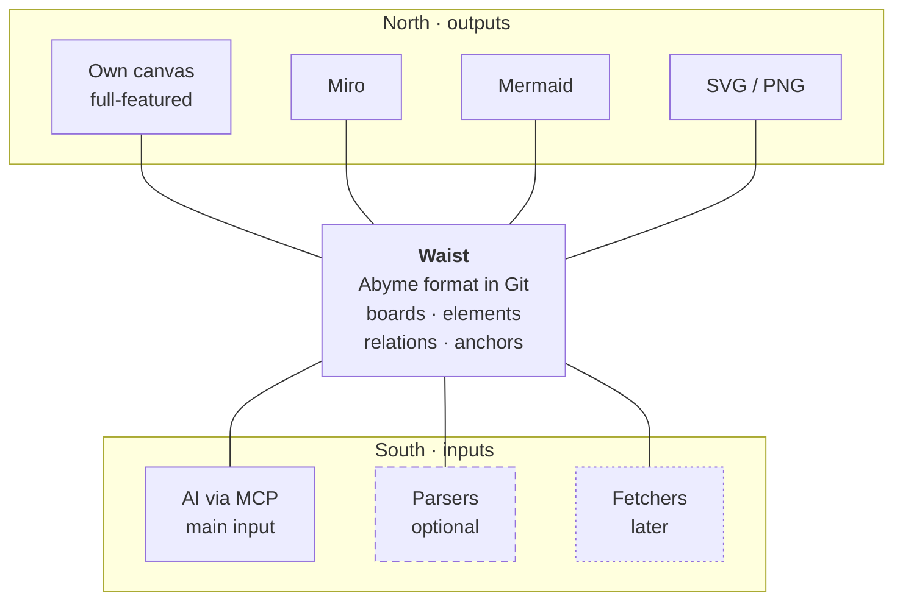

---
tags:
  - architecture
aliases:
  - Narrow Waist
  - Inputs
  - Input
  - Outputs
  - Output
  - Exports
---
# Hourglass

Abyme connects many inputs with many outputs through a narrow waist in the middle, the Abyme format. Without a shared middle, every output would have to know every input, which would be N × M combinations. With a waist, N + M implementations are enough.

What the waist contains is described in [[Data Model]], how it lies on disk in [[Storage in Git]].

## Inputs

**The AI via MCP is the main input.** It interprets any content, above all from the repo, and on request brings it into the Abyme format. Examples:

- “Create a representation of the architecture model.”
- “Visualize the relationships between the Markdown files and the code.”

The AI decides what goes on the board and how: which elements and relations, which [[Presentation]], and which arrangement. Through the same [[MCP Server]] it also reads Abyme as memory and context.

Other inputs:

- **People** edit the boards in the own [[Canvas]]. It is input and output at once.
- **Parsers** (optional) read known formats in the repo without the AI, such as `Cargo.toml`.
- **Fetchers** (later) fetch data from sources outside the repo, such as tickets.

Parsers and fetchers are [[Extensions]].

**Risk:** The main input depends on the AI, and its interpretation can be inaccurate. That is why the [[Checks#Verification Stamp|verification stamp]], the [[Boards and Zones#Statement Kind|statement kind]], and a possible confirmation by people matter (see provenance in [[Ideas]]).

## Outputs

- **The own [[Canvas]] is the only full-featured interface.** It knows all concepts, and people edit the boards there.
- **Exports go in one direction only:** Miro, Mermaid, SVG/PNG, Structurizr … They may lose information, because nothing flows back. If an export does not know a presentation, it shows a box with the summary.
- **The files themselves** are readable too: in an editor, as a diff in a pull request, or for an AI without MCP.

**Why not several full-featured interfaces?** Reconciling with Miro in both directions would mean translating edits made in Miro back into our model. But Miro knows neither modes nor references, review flags, or inner boards. The waist would have to follow Miro, and that is exactly what would limit Abyme. For parts of it, a two-way connection can be added later if it pays off.

## Proven Examples

| Example | one side | waist | other side |
|---|---|---|---|
| Internet | network technologies (Ethernet, Wi-Fi …) | IP | applications |
| LLVM | programming languages | LLVM IR | processor architectures |
| LSP | editors | Language Server Protocol | language servers |
| Pandoc | input formats | shared document model | output formats |

## Risks

- **The waist is too wide.** Then every input and output becomes expensive.
- **The waist is too narrow.** Then current/target, modes, or checks cannot be expressed.
- **The format changes.** Because it lives in Git, it needs a version number and migrations for the files.

> [!todo] Open
> - Which exports come first, and how does it become visible what gets lost?
> - How reliable must the AI's interpretation be before a zone counts as “current”? Does it need confirmation by a person?
